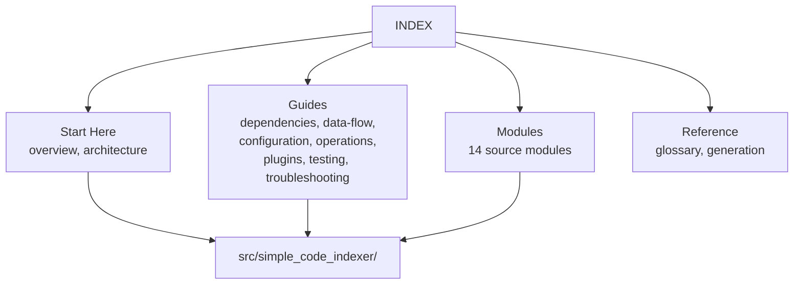

# Deepwiki Index

## Summary

- **Purpose**: A local code-index MCP server. It watches one workspace directory, indexes
  source files on save into SQLite/FTS5 (lexical) and Qdrant (semantic), and exposes three
  MCP tools — `search_code`, `symbol_lookup`, `get_status` — to AI coding assistants.
- **Tech stack**: Python 3.12, `uv` (build + dependency management), the official `mcp` SDK
  2.x over stdio, stdlib `sqlite3` with FTS5, `qdrant-client`, `httpx` for OpenAI-compatible
  embeddings, `watchdog` for filesystem events, `tree-sitter-language-pack` for parsing.
- **Entry points**: `simple-code-indexer` (console script → `simple_code_indexer:main`),
  `python setup.py` (interactive setup wizard), and three standalone probes under `tests/`.
- **Where to start**: [overview.md](overview.md) for the shape of the system,
  [architecture.md](architecture.md) for the runtime, [docs/tdd.md](../docs/tdd.md) for the
  build contract, and [GLOSSARY.md](../GLOSSARY.md) for the domain language.
- **How to navigate**: Start Here → Guides → Modules → Reference. **Modules** maps one page
  per source module; **Guides** covers the task-shaped material (configuration, operations,
  plugins, testing, troubleshooting).

## Start Here

- [Overview](overview.md) — purpose, repo layout, entry points, key workflows, pitfalls.
- [Architecture](architecture.md) — components, startup sequence, key flows, contracts,
  error handling, runtime topology.

## Guides

- [Dependencies](dependencies.md) — build/runtime deps, external services, dev tooling,
  compatibility and versioning notes.
- [Data Flow](data-flow.md) — index-on-save, sweeps, lexical/semantic/symbol queries, the
  storage contract and the failure modes.
- [Configuration](configuration.md) — precedence, every environment variable, every YAML key,
  validation rules, secrets, derived values.
- [Operations](operations.md) — install, run, verify, the acceptance path, rebuild, health
  checks.
- [Plugins](plugins.md) — the language-plugin and harness-plugin contracts, the builtin sets,
  collision rules.
- [Testing](testing.md) — the test inventory, the hermetic seams, the probes, the quality
  gates.
- [Troubleshooting](troubleshooting.md) — the symptom index for harness, indexing, service
  and tooling failures.

## Modules

| Module | Page | What it owns |
|---|---|---|
| MCP server | [server.md](modules/server.md) | Tool declarations, dispatch, startup sequence, status |
| Indexer | [indexer.md](modules/indexer.md) | `index_one_file`, `sweep`, the single-writer queue |
| Lexical store | [db.md](modules/db.md) | SQLite schema, FTS5 mirror, symbol and BM25 queries |
| Parser | [parse.md](modules/parse.md) | Language detection, tree-sitter extraction, chunking |
| Embeddings client | [embed.md](modules/embed.md) | The OpenAI-compatible POST, splitting and pooling |
| Semantic store | [qdrant-store.md](modules/qdrant-store.md) | Collection lifecycle, point IDs, search |
| Settings | [config.md](modules/config.md) | Discovery, precedence, the `Settings` dataclass |
| Watcher | [watcher.md](modules/watcher.md) | Native events, debounce, per-directory watches |
| Managed services | [services.md](modules/services.md) | Starting and awaiting the Docker containers |
| Workspace lock | [workspace-lock.md](modules/workspace-lock.md) | The single-writer lease |
| Plugin registry | [registry.md](modules/registry.md) | Plugin loading, collisions, allowlists |
| Builtin plugins | [builtin-plugins.md](modules/builtin-plugins.md) | The 36 shipped languages |
| Harness plugins | [harnesses.md](modules/harnesses.md) | Where each MCP client keeps its server list |
| Setup wizard | [setup-wizard.md](modules/setup-wizard.md) | The interactive first-run flow |

## Reference

- [Glossary](glossary.md) — the canonical domain language, grouped by area.
- [Assets](assets/README.md) — the image/diagram asset folder, its naming convention and
  the diagram inventory.
- [Generation Metadata](GENERATION.md) — the commit, branch and timestamp of this build.

## Quick Command Reference

```bash
# Set up a machine
python setup.py --dry-run     # show every action, change nothing
python setup.py               # interactive setup

# Verify, in this order
uv run python tests/service_probe.py     # embeddings + Qdrant
uv run python tests/mcp_probe.py         # stdio MCP contract
uv run python tests/live_watch_probe.py  # index-on-save latency

# Quality gates
uv run ruff check . && uv run ruff format . && uv run pyright && uv run pytest
```

## Diagrams



## Generation Metadata

| Field | Value |
|---|---|
| Commit | `bf859e22745bff1f4a5c921606a48f26e709e9` (`bf859e2`) |
| Branch | `master` |
| Generated | 2026-10-20 08:45 (+05:30) |
| Language | English |

Full details: [GENERATION.md](GENERATION.md).

## Source References

- `README.md`
- `AGENTS.md`
- `docs/tdd.md`
- `GLOSSARY.md`
- `NOTES.md`
- `ISSUES.md`
- `docs/adr/0004-single-writer-sqlite-wal.md`
- `docs/adr/0006-harness-safe-mcp-surface.md`
- `docs/adr/0008-host-spawned-cwd-per-repo-collections.md`
- `docs/adr/0009-setup-wizard-managed-services-config.md`
- `src/simple_code_indexer/server.py`
- `src/simple_code_indexer/indexer.py`
- `pyproject.toml`