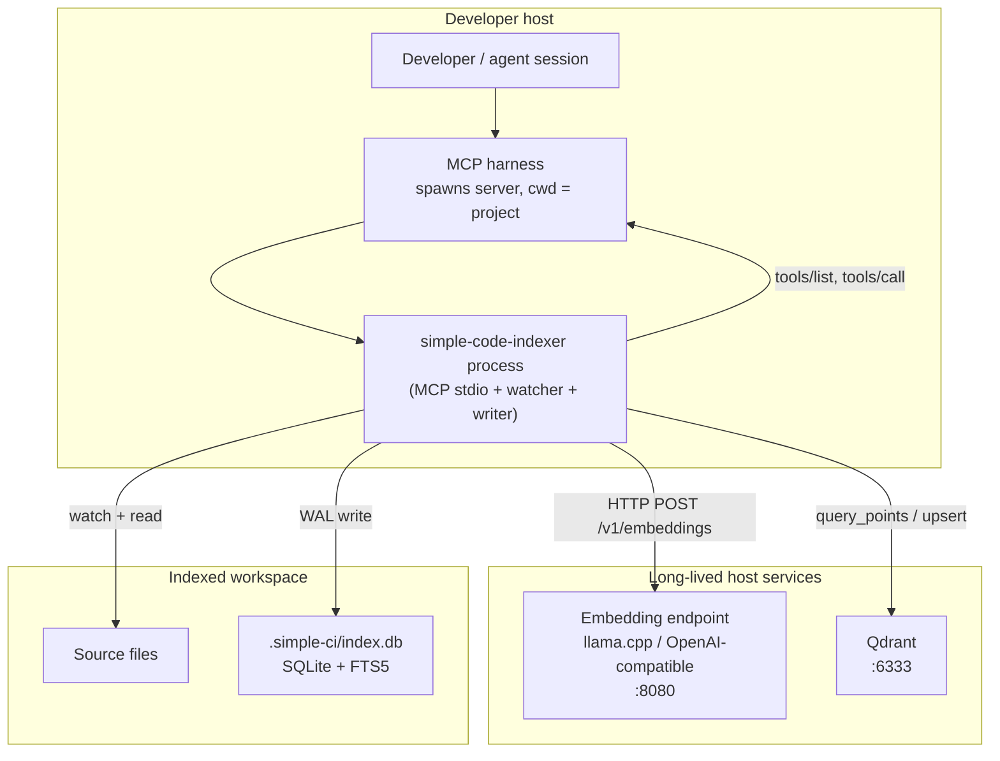
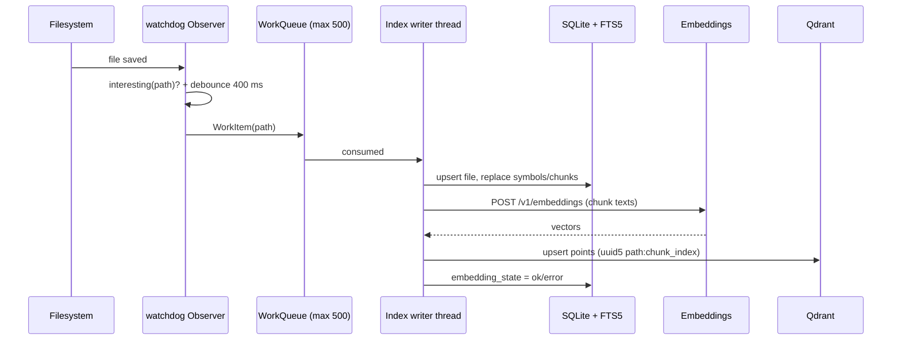
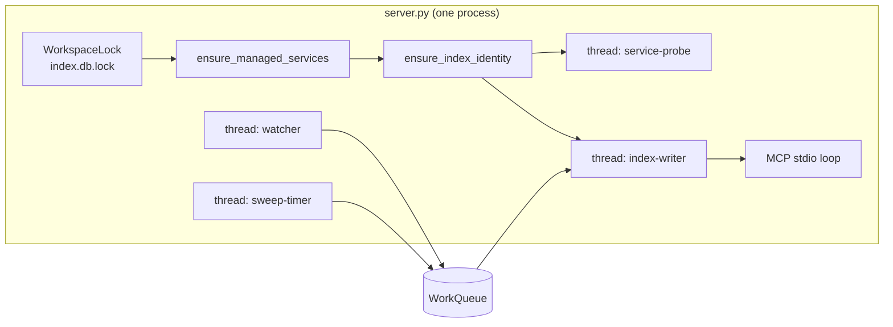

# Architecture

## System Context

The system is a **single host process per harness session**. The harness (Claude Code, Codex,
Cursor, MiMoCode, …) spawns it over stdio with the session's project as the process working
directory. The process is the MCP server, the file watcher, and the index writer at once.



Boundaries that matter:

- **The harness is the process boundary.** The server inherits the harness cwd; that cwd *is*
  the workspace (`WORKSPACE_ROOT` overrides). `get_status.workspace` is the only way to verify
  what a live harness actually spawned.
- **The embedding endpoint and Qdrant are outside the process.** Both are optional at runtime:
  lexical search works with either down (fail-soft).
- **One workspace, one collection.** No multi-repo registry, no path sandbox.

## Components

| Component | Module | Responsibility |
|---|---|---|
| MCP server | `server.py` | Tool declarations, `tools/call` dispatch, status payload, startup sequencing |
| Index writer | `indexer.py` | The unit of work (`index_one_file`), reconciliation `sweep`, single-writer queue consumer |
| Watcher | `watcher.py` | watchdog Observer → per-path debounce → work queue items |
| Lexical store | `db.py` | Schema, WAL connections, FTS5 mirror + triggers, symbol queries |
| Semantic store | `qdrant_store.py` | Collection lifecycle, stable point IDs, upsert / delete-by-path / search |
| Embeddings client | `embed.py` | OpenAI-compatible POST, char-budget splitting + mean pooling, retries |
| Parser | `parse.py` | Language detection, tree-sitter symbol extraction, line-aligned chunking |
| Plugin registry | `registry.py` | Loads builtin + user language plugins, owns the allowlists |
| Settings | `config.py`, `configfile.py` | Layered YAML discovery, env overrides, frozen `Settings` |
| Managed services | `services.py` | Starts/waits for Docker containers at boot; records state, never raises |
| Workspace lock | `workspace_lock.py` | OS advisory lease enforcing one writer per workspace |
| Setup wizard | `setup_wizard/` | Interactive setup: prompts, probes, provisioning, config + harness writes |
| Harness plugins | `harnesses/` | Where each MCP client keeps its server list, and how to merge an entry |

## Key Flows

### Startup sequence (`server._run`)

1. `load_settings()` — resolve workspace, config file, endpoints, allowlists.
2. `_acquire_workspace_lock()` — take `<index.db>.lock`; `SystemExit(1)` if another live
   server already owns the workspace.
3. `services.ensure_managed_services(settings)` — start/await managed containers (bounded by
   `startup_timeout_s`, fail-soft).
4. `start_prefetch_thread()` — warm tree-sitter grammars in the background.
5. `db.ensure_schema(conn)` + `db.ensure_index_identity(conn, qdrant_url=…, collection=…)` —
   wipe rows if the DB was bound to another endpoint/collection.
6. Start the **service-probe** thread (warm Qdrant collection + embedding endpoint).
7. Start the **index-writer** thread; enqueue `SWEEP_REQUEST` (startup reconcile).
8. Start the **watcher** on its own daemon thread.
9. Start the **sweep-timer** thread (`time.sleep(sweep_seconds)` → `SWEEP_REQUEST`).
10. Serve MCP over `stdio_server()`; release the lock on exit.

### Index-on-save (the hot path)

1. Native filesystem event → `watcher.Handler.on_modified` / `on_created`.
2. `interesting(path)` filters by allowlist, temp-name and ignore-dir rules.
3. A `threading.Timer` per path (400 ms) collapses editor temp+rename bursts.
4. Timer fires → `WorkItem(path)` → `work_queue.put_nowait` (bounded at 500; a full queue
   drops the item and the sweep covers it).
5. `writer_loop` consumes it → `index_one_file(settings, path)`.
6. `index_one_file` — allowlist check → read bytes → sha256 → hash short-circuit → parse
   symbols → chunk → one SQLite transaction (upsert file, replace symbols, replace chunks).
7. `_embed_and_store` — embed chunk texts → Qdrant upsert by stable point ID → record
   `embedding_state` (`ok` / `error`). Failures are logged, never fatal.

### Query path

- **Lexical** — `db.fts_search` on a read-only WAL connection. Query tokens are normalised to
  `"tok" OR "tok"`; BM25 rank is negated into a positive score.
- **Semantic** — embed the query with the same endpoint used for chunks → `qdrant_store.search`
  → map each point back to a chunk row via `db.get_chunk`. Points whose chunk vanished are
  skipped (the lexical row is the source of truth).
- **Symbols** — exact name match first, then a `LIKE 'name%'` prefix match.

## Diagrams





## Interfaces and Contracts

### MCP tool surface (exactly three tools)

| Tool | Input | Output shape |
|---|---|---|
| `search_code` | `query` (string, required), `semantic` (bool, default `false`), `limit` (int, default `10`, clamped 1..50) | `{"hits": [{file, line, end_line, snippet, score, source}], "source": "lexical"\|"semantic"}` |
| `symbol_lookup` | `symbol` (string, required) | Single match: flat object; multiple: `{symbol, found: true, matches: []}` sorted by path; none: `{symbol, found: false, matches: []}` |
| `get_status` | none | Counts, watcher liveness, `last_sweep`, `qdrant_ok`, `embed_ok`, `workspace`, `collection`, `index_db`, `config_file`, `services` |

Deliberately absent: `outputSchema`, `capabilities.tasks`, `execution.taskSupport` (ADR-0006).
Handler style is the MCP SDK 2.x constructor form — `Server(name, on_list_tools=…, on_call_tool=…)`
— with snake_case model fields (`input_schema=`, `is_error=`) serialised camelCase on the wire.

### Internal contracts

| Contract | Producer → Consumer | Shape |
|---|---|---|
| `WorkItem` | watcher → indexer | frozen dataclass: `path: Path`, `deleted: bool = False` |
| `SweepRequest` | server/timer → indexer | sentinel class instance (`indexer.SWEEP_REQUEST`) |
| `IndexOutcome` | indexer → callers | NamedTuple: `path`, `status`, `duration_ms` |
| `SweepStats` | indexer → callers | NamedTuple: `checked`, `indexed`, `unchanged`, `removed`, `errors` |
| `Settings` | config → every module | frozen slots dataclass, 17 fields |
| `LanguageSpec` | registry → parse | frozen dataclass: name, grammar, extensions, filenames, symbol_nodes, extract |
| `HarnessSpec` | harness loader → wizard | frozen dataclass: name, label, dirs, configs, format, entry, render |

### Storage contracts

| Store | Identity | Payload / columns |
|---|---|---|
| `files` | `path` (unique) | language, size, sha256, mtime, indexed_at |
| `symbols` | (`file_id`, name, line) | kind, line_end, signature |
| `chunks` | (`file_id`, chunk_index) | start_line, end_line, content |
| `chunks_fts` | external-content FTS5 over `chunks` | content only, kept in sync by three triggers |
| `embedding_state` | `chunk_id` | qdrant_point_id, status (`ok`/`error`), updated_at |
| `meta` | key | `qdrant_url`, `qdrant_collection` — the index identity binding |
| Qdrant point | `uuid5(NAMESPACE_URL, f"{path}:{chunk_index}")` | payload `{path, chunk_index}` |

## Key Parameters

| Parameter | Env var | Default | Notes |
|---|---|---|---|
| Workspace | `WORKSPACE_ROOT` | `Path.cwd().resolve()` | The harness spawn directory |
| Config discovery | `SIMPLE_CI_CONFIG` | discovery | `none`/`off` disables discovery (tests set this) |
| Index DB | `INDEX_DB` | `<workspace>/.simple-ci/index.db` | |
| Qdrant URL | `QDRANT_URL` | `http://localhost:6333` | |
| Collection | `QDRANT_COLLECTION` | derived per workspace | `code_index_{slug}_{hash8}_{dim}` |
| Embedding base URL | `EMBED_BASE_URL` | `http://localhost:8080` | `/v1/embeddings` is appended |
| Embedding model | `EMBED_MODEL` | `Qwen3-Embedding-4B-Q6_K` | |
| Embedding dimension | `EMBED_DIM` | `2560` | Must match the endpoint exactly |
| API key | `EMBED_API_KEY` | unset | Sent as a bearer token |
| Embed timeout | `EMBED_TIMEOUT_S` | `15.0` | Connect timeout capped at 1 s |
| Sweep interval | `SWEEP_SECONDS` | `45.0` | Reconciliation backstop |
| Debounce | `DEBOUNCE_MS` | `400` | Per-path timer window |
| Grammar prefetch | `PREFETCH_GRAMMARS` | `1` | `0` disables the background prefetch thread |

## Error Handling and Reliability

- **Fail soft on the index path.** An embedding or Qdrant failure logs a warning, marks
  `embedding_state.status = 'error'`, and the file still lands in the lexical index.
- **Retry on the next sweep.** `reembed_pending` re-embeds every chunk whose status is not
  `ok`, independent of the hash/mtime short circuits, and stops at the first failing file so a
  downed endpoint costs one retry per sweep instead of one per file.
- **Single writer, enforced by lock.** The OS advisory lock on `index.db.lock` makes a second
  server for the same workspace exit instead of racing. The lease is the open file handle, so
  a killed session leaves no stale lock.
- **Index identity binding.** `ensure_index_identity` drops every row when the DB's recorded
  endpoint/collection differs from the current one (or when rows exist with no recorded
  identity), so the startup reconcile re-embeds instead of leaving vectorless rows.
- **Collection validation.** `ensure_collection` rejects a collection whose configured vector
  size differs from `EMBED_DIM`, or that uses named vectors — loudly, with both numbers.
- **Managed services never block forever.** Container startup is bounded by
  `startup_timeout_s`; afterwards the state is reported (`running` / `started` / `unavailable`
  / `not_managed`) and lexical search continues.
- **Queue overflow.** A full work queue drops the item and logs a warning; the sweep is the
  backstop.
- **Per-file isolation.** One unreadable or unparseable file logs and continues.

## Example Snippets

Workspace lock acquisition — the single-writer invariant:

```python
def _acquire_workspace_lock(index_db_path: Path) -> workspace_lock.WorkspaceLock:
    """Enforce one writer per workspace; the lease dies with the process."""
    lock = workspace_lock.WorkspaceLock(index_db_path)
    if not lock.acquire():
        logger.error(
            "another simple-code-indexer already owns %s; refusing to start",
            index_db_path,
        )
        raise SystemExit(1)
    return lock
```

The hash short-circuit that makes no-op saves free:

```python
digest = hashlib.sha256(data).hexdigest()
source = data.decode("utf-8", errors="replace")
with db.connect(settings.index_db_path) as conn:
    db.ensure_schema(conn)
    if db.file_hash(conn, rel) == digest:
        return done("skipped_unchanged")
```

## Runtime and Deployment

- **No container for the server itself.** `Dockerfile` and `docker-compose.yml` were removed
  with ADR-0008; the harness spawns a host process.
- **The server exits with the session.** There is nothing to stop.
- **Backing services are long-lived**: Qdrant on `:6333`, embeddings on `:8080`. They may be
  managed by the wizard (a `service` block in `config.yaml`) or owned by the user.
- **Harness entries** are written by the wizard; the typical one is
  `uvx --from <repo> simple-code-indexer`. The first launch builds into a cached environment
  (~5 s), later launches are ~0.3 s.
- **Harness tool timeout** defaults to 5000 ms; managed containers block startup, so the
  wizard writes `timeout: 120000`.

## Scaling Notes

- The indexer is **single-writer and single-workspace** by design; there is no horizontal
  scaling story, by decision (ADR-0007, ADR-0004).
- The expensive part of a sweep is embedding, not parsing. `reembed_pending` stops at the
  first failure to avoid hammering a down service.
- Chunking is line-aligned and bounded by 80 lines / 2000 chars, so a huge file produces many
  small chunks — cheap to embed in batches, cheap to delete by path.
- The Qdrant collection is per workspace, so search payload and point count scale with the
  number of chunks in that workspace only.
- Watcher cost scales with the number of *interesting directories*, not file count — one
  non-recursive watch per directory.

## Source References

- `src/simple_code_indexer/server.py`
- `src/simple_code_indexer/indexer.py`
- `src/simple_code_indexer/watcher.py`
- `src/simple_code_indexer/db.py`
- `src/simple_code_indexer/qdrant_store.py`
- `src/simple_code_indexer/embed.py`
- `src/simple_code_indexer/parse.py`
- `src/simple_code_indexer/registry.py`
- `src/simple_code_indexer/config.py`
- `src/simple_code_indexer/configfile.py`
- `src/simple_code_indexer/services.py`
- `src/simple_code_indexer/workspace_lock.py`
- `src/simple_code_indexer/models.py`
- `src/simple_code_indexer/errors.py`
- `docs/adr/0004-single-writer-sqlite-wal.md`
- `docs/adr/0006-harness-safe-mcp-surface.md`
- `docs/adr/0008-host-spawned-cwd-per-repo-collections.md`
- `docs/tdd.md`