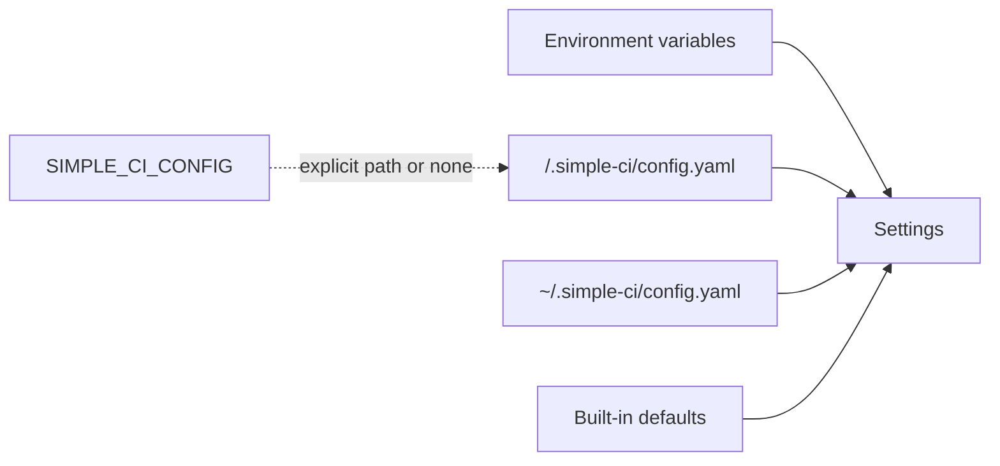

# Configuration

Everything that can change the server's behaviour, and where it comes from.

## Resolution Order

1. **Environment variable** — the highest precedence; every setting has one.
2. **`<workspace>/.simple-ci/config.yaml`** — the per-project file.
3. **`~/.simple-ci/config.yaml`** — the global file, used when the project has no local one.
4. **Built-in default**.

`SIMPLE_CI_CONFIG` short-circuits the *file* discovery: set it to an explicit path to use
that file, or to `none` / `off` to disable discovery entirely (the test suite uses `none`).


## Environment Variables

| Variable | Default | Purpose |
|---|---|---|
| `WORKSPACE_ROOT` | `Path.cwd().resolve()` | The workspace to index and watch |
| `SIMPLE_CI_CONFIG` | discovery | Explicit config path; `none`/`off` disables discovery |
| `INDEX_DB` | `<workspace>/.simple-ci/index.db` | Where the SQLite index lives |
| `QDRANT_URL` | `http://localhost:6333` | The Qdrant endpoint |
| `QDRANT_COLLECTION` | derived per workspace | Override the derived collection name |
| `EMBED_BASE_URL` | `http://localhost:8080` | The embedding endpoint (`/v1/embeddings` is appended) |
| `EMBED_MODEL` | `Qwen3-Embedding-4B-Q6_K` | The model name sent to the endpoint |
| `EMBED_DIM` | `2560` | The vector length the endpoint must produce |
| `EMBED_API_KEY` | unset | Optional bearer token |
| `EMBED_TIMEOUT_S` | `15.0` | Read timeout for the embedding POST |
| `SWEEP_SECONDS` | `45.0` | Interval of the reconciliation sweep |
| `DEBOUNCE_MS` | `400` | Per-path debounce window |
| `PREFETCH_GRAMMARS` | `1` | `0` disables the background grammar prefetch |
| `HF_TOKEN` | unset | Sent as a bearer token when the wizard downloads a GGUF |

## The Config File

```yaml
version: 1
embedding:
  base_url: http://localhost:8080
  model: embeddinggemma-2
  dim: 768                 # must match the endpoint; the wizard probes it
  api_key: null
  timeout_s: 15
  service:                 # optional: server starts this container at boot
    container: simple-ci-embed
    compose_file: /home/you/.simple-ci/docker-compose.yml
    compose_service: embed
    startup_timeout_s: 60
qdrant:
  url: http://localhost:6333
  service:
    container: simple-ci-qdrant
    compose_file: /home/you/.simple-ci/docker-compose.yml
    compose_service: qdrant
    startup_timeout_s: 45
sweep_seconds: 45
debounce_ms: 400
```

### Key reference

| Key | Type | Default | Notes |
|---|---|---|---|
| `version` | int | — | `1`; a different value logs a warning, the build proceeds |
| `embedding.base_url` | string | `http://localhost:8080` | `/v1/embeddings` is appended |
| `embedding.model` | string | `Qwen3-Embedding-4B-Q6_K` | The name the endpoint expects |
| `embedding.dim` | int | `2560` | Must equal the endpoint's real vector length |
| `embedding.api_key` | string\|null | `null` | Sent as `Authorization: Bearer` |
| `embedding.timeout_s` | number | `15` | Read timeout; connect timeout is capped at 1 s |
| `embedding.service.container` | string | — | Required when `embedding.service` is present |
| `embedding.service.compose_file` | string\|null | `null` | Used when the container does not exist |
| `embedding.service.compose_service` | string\|null | `null` | The compose service to bring up |
| `embedding.service.startup_timeout_s` | number | `45` | How long to wait for the endpoint |
| `qdrant.url` | string | `http://localhost:6333` | |
| `qdrant.collection` | string\|null | derived | Overrides the derived name |
| `qdrant.service.*` | — | — | The same four keys as `embedding.service` |
| `sweep_seconds` | number | `45` | Reconciliation interval |
| `debounce_ms` | int | `400` | Per-path debounce window |

## Validation Rules

| Situation | Result |
|---|---|
| The root YAML is not a mapping | `ConfigError: config <path> must contain a mapping` |
| `embedding` is not a mapping | `ConfigError: 'embedding' must be a mapping` |
| `embedding.dim` is a string | `ConfigError: 'embedding.dim' must be an integer` |
| `embedding.dim` is a bool | Rejected — `bool` is not accepted as an int |
| `embedding.timeout_s` is a string | `ConfigError: 'embedding.timeout_s' must be a number` |
| `embedding.service` is not a mapping | `ConfigError: 'embedding.service' must be a mapping` |
| `embedding.service.container` is empty | `ConfigError: 'embedding.service.container' must be a non-empty string` |
| `embedding.service.startup_timeout_s` is a bool | `ConfigError: … must be a number` |
| The file is empty | Treated as `{}` — all defaults |
| The file has an unknown `version` | A warning is logged; the build proceeds |
| `EMBED_DIM` is not an integer | `ConfigError: EMBED_DIM must be an integer, got 'x'` |

## Secrets

- The API key lives in `embedding.api_key` (the file is written `0600` on POSIX) or in
  `EMBED_API_KEY`.
- **Never** set `OPENAI_API_KEY` — it enables real `api.openai.com` retries.
- Local config lives inside the gitignored `.simple-ci/` directory for exactly this reason.

## Managed Services

A `service` block names a Docker container the server starts and waits for at boot:

| Field | Meaning |
|---|---|
| `container` | The container name to inspect/start |
| `compose_file` | The compose file used when the container does not exist |
| `compose_service` | The compose service to bring up |
| `startup_timeout_s` | How long to wait for the endpoint to answer |

Behaviour: the server **never refuses to start**. If Docker or the service is unavailable it
logs the problem, keeps lexical search working, and reports the state in
`get_status.services` (`running`, `started`, `unavailable`, `not_managed`).

## Derived Values

| Derived | Formula | Example |
|---|---|---|
| Collection name | `code_index_{slug}_{sha256(normalized path)[:8]}_{embed_dim}` | `code_index_my-app_a1b2c3d4_2560` |
| Slug | folder name, non-alphanumerics → `-`, capped at 32 chars, `root` when empty | `my-app` |
| Path hash input | resolved, lowercased, forward slashes | `d:/projects/my-app` |
| Index path | `<workspace>/.simple-ci/index.db` | |
| Lock path | `<index path>.lock` | |

Lowercasing the hash input is deliberate: it stops Windows drive-letter case from splitting
one project across two collections.

## Where Files Live

| Path | Contents |
|---|---|
| `~/.simple-ci/config.yaml` | Global config (used when the project has no local config) |
| `<project>/.simple-ci/config.yaml` | Per-project config; wins over the global file |
| `<project>/.simple-ci/index.db` | SQLite index (+ WAL files and the single-writer lock) |
| `~/.simple-ci/docker-compose.yml` | Services the wizard generated (`embed`, `qdrant`) |
| `~/.simple-ci/models/` | Downloaded GGUF files |

## Example Snippets

Reading one value with both sources and a default:

```python
embed_dim = _pick_int(
    "EMBED_DIM", configfile.get_int(embedding, "dim", where="embedding"), 2560
)
```

Writing the config atomically with restrictive permissions:

```python
def write_config(data: dict[str, Any], path: Path) -> None:
    """Atomically write a YAML config (0600 on POSIX: it may hold an API key)."""
    path.parent.mkdir(parents=True, exist_ok=True)
    text = yaml.safe_dump(data, sort_keys=False, allow_unicode=True)
    temporary = path.with_name(path.name + ".tmp")
    temporary.write_text(text, encoding="utf-8", newline="\n")
    os.replace(temporary, path)
    if os.name == "posix":
        path.chmod(0o600)
```

## Diagrams



The diagram shows how a single setting is resolved from the environment, the two
config files and the built-in defaults.
## Source References

- `src/simple_code_indexer/config.py`
- `src/simple_code_indexer/configfile.py`
- `src/simple_code_indexer/setup_wizard/__init__.py`
- `src/simple_code_indexer/setup_wizard/write.py`
- `src/simple_code_indexer/setup_wizard/provision.py`
- `src/simple_code_indexer/services.py`
- `src/simple_code_indexer/registry.py`
- `src/simple_code_indexer/server.py`
- `tests/test_config.py`
- `tests/test_configfile.py`
- `docs/adr/0009-setup-wizard-managed-services-config.md`
- `docs/tdd.md`