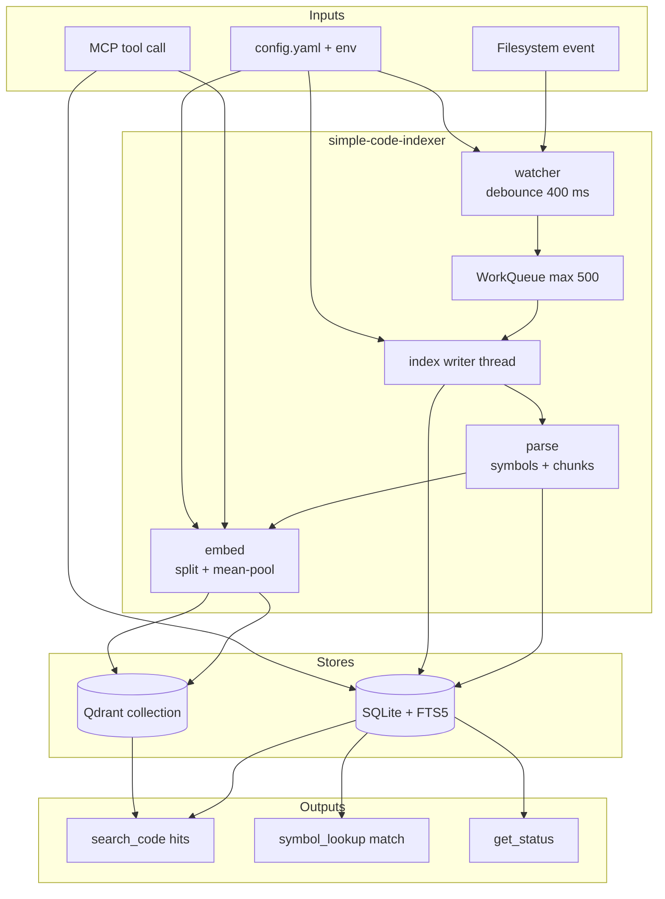
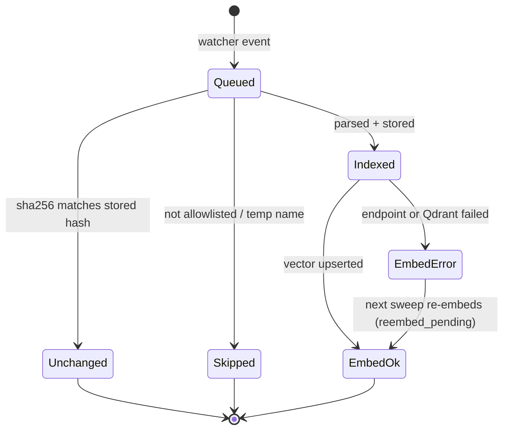

# Data Flow

## Primary Flows

- **Index on save** — a native filesystem event becomes one index job: debounce → queue →
  single writer → parse → SQLite transaction → embed → Qdrant upsert.
- **Startup reconcile** — one full-tree sweep at process start picks up everything that
  changed while the system was down.
- **Reconciliation sweep** — every `SWEEP_SECONDS` (45 s) the tree is walked, drift is
  re-indexed, vanished paths are deleted, and failed embeddings are retried.
- **Lexical query** — `search_code(query)` → FTS5 BM25 over chunk text → join to `files` for
  path and line range.
- **Semantic query** — `search_code(query, semantic=true)` → embed the query → Qdrant
  nearest-chunk search → map points back to chunk rows in SQLite.
- **Symbol query** — `symbol_lookup(symbol)` → exact name match, then prefix match.
- **Setup flow** — `python setup.py` → probe endpoints → write `config.yaml` → register the
  server with the selected harnesses.

## Step-by-Step

### 1. Index on save

1. The OS delivers a native `modify`/`create` event to the watchdog Observer.
2. `watcher.Handler.interesting(path)` rejects anything outside the allowlist, matching an
   editor temp name (`*~`, `*.tmp`, `*.swp`, `*.swx`, `*.part`, `.#*`), or inside an ignored
   directory (`.git`, `.index`, `.simple-ci`, `__pycache__`, `.venv`, `node_modules`).
3. A per-path `threading.Timer(debounce_ms / 1000)` is (re)started; a previous timer for the
   same path is cancelled, collapsing temp+rename bursts into one job.
4. The timer fires → `WorkItem(path)` → `work_queue.put_nowait`. A full queue (500) drops the
   item with a warning; the sweep is the backstop.
5. `writer_loop` pops the item and calls `index_one_file(settings, path)`.
6. `index_one_file` re-checks the filters, reads the bytes, computes `sha256`, and compares it
   with the stored hash — an unchanged file returns `skipped_unchanged` immediately.
7. `parse.detect_language(path)` resolves the plugin, `parse.extract_symbols(path, source)`
   extracts symbols, `parse.chunk_source(source)` produces line-aligned chunks
   (≤80 lines, ≤2000 chars).
8. One SQLite transaction: `upsert_file`, `replace_file_symbols`, `replace_file_chunks`.
   FTS5 stays aligned through the `chunks_ai` / `chunks_ad` / `chunks_au` triggers.
9. `_embed_and_store` embeds the chunk texts, upserts Qdrant points keyed by
   `uuid5(NAMESPACE, f"{path}:{chunk_index}")`, then records `embedding_state` rows
   (`ok` or `error`).
10. The outcome is returned as an `IndexOutcome(path, status, duration_ms)`.

### 2. Reconciliation sweep

1. `reembed_pending(settings)` runs first — it re-embeds chunks whose `embedding_state.status`
   is not `ok` (or which have no row), independent of the file hash/mtime short circuits, and
   stops at the first failing file.
2. The stored `(mtime, size)` map is loaded from `files`.
3. `iter_workspace_files` walks the tree with `os.walk`, pruning ignored directories, and
   yields allowlisted files.
4. For each file: if `(mtime, size)` matches the stored value it is counted `unchanged`;
   otherwise `index_one_file` runs.
5. Stored paths that were not seen are deleted from SQLite and their Qdrant points are
   removed by path filter.
6. `LAST_SWEEP` is stamped with the current UTC time (read by `get_status`).

## Inputs and Outputs

| Type | Name | Location | Description |
| --- | --- | --- | --- |
| Input | Workspace root | process cwd, or `WORKSPACE_ROOT` | The single directory that is indexed and watched |
| Input | Source files | workspace tree | Code files matching a plugin extension or exact filename |
| Input | Config file | `<workspace>/.simple-ci/config.yaml`, then `~/.simple-ci/config.yaml` | Endpoints, dimension, timings, managed services |
| Input | Environment | process env | `EMBED_*`, `QDRANT_*`, `SWEEP_SECONDS`, `DEBOUNCE_MS`, … — overrides the file |
| Input | MCP tool call | stdio JSON-RPC | `search_code` / `symbol_lookup` / `get_status` arguments |
| Input | Filesystem event | watchdog Observer | create / modify / move / delete under the workspace |
| Output | Lexical index | `<workspace>/.simple-ci/index.db` | `files`, `symbols`, `chunks`, `chunks_fts`, `embedding_state`, `meta` |
| Output | Semantic index | Qdrant collection `code_index_{slug}_{hash8}_{dim}` | One point per chunk, payload `{path, chunk_index}` |
| Output | Tool result | stdout (MCP channel) | JSON payload: hits, symbol match, or status object |
| Output | Logs | stderr only | Never files in the workspace root |
| Output | Status snapshot | `get_status` | Counts, `last_sweep`, `qdrant_ok`, `embed_ok`, `workspace`, `collection`, `services` |

## Data Structures

### Domain records (`models.py`, all frozen)

```python
@dataclass(frozen=True, slots=True)
class FileRecord:
    path: str; language: str; size: int; sha256: str; mtime: float

@dataclass(frozen=True, slots=True)
class Symbol:
    name: str; kind: str; line: int
    line_end: int | None = None; signature: str | None = None
    path: str | None = None; language: str | None = None

@dataclass(frozen=True, slots=True)
class Chunk:
    chunk_index: int; start_line: int; end_line: int; content: str

@dataclass(frozen=True, slots=True)
class SearchHit:
    path: str; line: int; end_line: str; snippet: str; score: float; source: str = "lexical"
```

### Qdrant payload

```python
PointStruct(
    id=str(point_id(path, chunk.chunk_index)),   # uuid5(NAMESPACE_URL, f"{path}:{chunk_index}")
    vector=vector,
    payload={"path": path, "chunk_index": chunk.chunk_index},
)
```

### SQLite identity binding (`meta`)

| Key | Value | Effect on mismatch |
| --- | --- | --- |
| `qdrant_url` | `http://localhost:6333` | Every row is dropped; startup reconcile re-indexes |
| `qdrant_collection` | `code_index_my-app_a1b2c3d4_2560` | Every row is dropped; startup reconcile re-indexes |

### Chunking rules

| Bound | Value | Where |
| --- | --- | --- |
| Max lines per chunk | 80 | `parse.chunk_source(max_lines=80)` |
| Max chars per chunk | 2000 | `parse.chunk_source(max_chars=2000)` |
| Embed piece budget | 1200 chars | `embed._SAFE_CHARS` (llama.cpp 512-token batch limit) |
| Chunk overlap | none | Chunks are contiguous windows |

## Diagrams





## State and Storage

| Store | Location | Lifetime | Notes |
| --- | --- | --- | --- |
| Lexical index | `<workspace>/.simple-ci/index.db` (+ `-wal`, `-shm`) | Persistent, gitignored | WAL mode, `busy_timeout=5000`, `foreign_keys=ON` |
| Workspace lock | `<workspace>/.simple-ci/index.db.lock` | Process lifetime | The open handle *is* the lease; the file may outlive the process |
| Semantic index | Qdrant collection | Persistent | One collection per workspace + dimension |
| Index identity | `meta` table in the DB | Persistent | Binds the DB to one endpoint + collection |
| Embedding state | `embedding_state` table | Persistent | `ok` / `error` per chunk; drives `reembed_pending` |
| Config | `.simple-ci/config.yaml` | Persistent | Read once at startup; a restart is required to pick up changes |
| In-memory | `parse._parsers`, `registry._REGISTRY`, `qdrant_store._ensured_collections` | Process lifetime | Lazily populated; grammars prefetched in a background thread |

## Example Snippets

Lexical search — query normalisation and BM25 → positive score:

```python
def _fts_match_expression(query: str) -> str | None:
    tokens = re.findall(r"\w+", query, flags=re.UNICODE)
    if not tokens:
        return None
    return " OR ".join(f'"{t}"' for t in tokens)

# ...in fts_search:
rows = conn.execute(_FTS_SELECT, (match, limit)).fetchall()
return [SearchHit(..., score=-float(row["rank"]), source="lexical") for row in rows]
```

Semantic search — map points back to chunk rows:

```python
for vector_hit in vector_hits:
    span = db.get_chunk(conn, vector_hit.path, vector_hit.chunk_index)
    if span is None:
        continue  # orphan point (delete raced); lexical row is source of truth
    hits.append({
        "file": vector_hit.path,
        "line": span.start_line,
        "end_line": span.end_line,
        "snippet": span.content[:300],
        "score": vector_hit.score,
        "source": "semantic",
    })
```

Symbol lookup — exact match first, then prefix:

```python
rows = conn.execute(select.format(where="s.name = ?"), (name,)).fetchall()
if not rows:
    rows = conn.execute(
        select.format(where="s.name LIKE ? ESCAPE '\\'"),
        (name.replace("\\", "\\\\").replace("%", r"\%").replace("_", r"\_") + "%",),
    ).fetchall()
```

## Failure Modes

| Failure | Detection | Handling |
| --- | --- | --- |
| Embedding endpoint down | `EmbedError` after 3 attempts | Chunk indexed lexically; `embedding_state='error'`; retried next sweep |
| Vector dimension mismatch | `EmbedError` "dimension mismatch" | Nothing is stored; every chunk retries each sweep until aligned |
| Qdrant unreachable | `QdrantUnavailable` | Lexical index unaffected; `qdrant_ok: false` in status |
| Collection vector size mismatch | `QdrantUnavailable` with both sizes | Loud failure instead of silently vectorless workspace |
| Orphan Qdrant point | `db.get_chunk` returns `None` | Point skipped at query time |
| File deleted under the watcher | `on_deleted` → `WorkItem(deleted=True)` | Rows deleted (FK cascade) + points deleted by path filter |
| File deleted between walk and stat | `OSError` on `path.stat()` | Skipped this pass; the next sweep removes the stale row |
| Dropped filesystem event | sweep compares `mtime`+`size` | Re-indexed by the sweep |
| Work queue full | `queue.Full` on `put_nowait` | Item dropped with a warning; the sweep covers it |
| Second server for the same workspace | lock acquisition fails | `SystemExit(1)` with a clear log line |
| Unreadable file | `OSError` on `read_bytes` | Logged; outcome `error`; the walk continues |

## Source References

- `src/simple_code_indexer/indexer.py`
- `src/simple_code_indexer/watcher.py`
- `src/simple_code_indexer/db.py`
- `src/simple_code_indexer/embed.py`
- `src/simple_code_indexer/qdrant_store.py`
- `src/simple_code_indexer/parse.py`
- `src/simple_code_indexer/server.py`
- `src/simple_code_indexer/models.py`
- `src/simple_code_indexer/config.py`
- `src/simple_code_indexer/workspace_lock.py`
- `src/simple_code_indexer/services.py`
- `docs/tdd.md`
- `docs/adr/0001-index-on-save-not-git-state.md`
- `docs/adr/0004-single-writer-sqlite-wal.md`