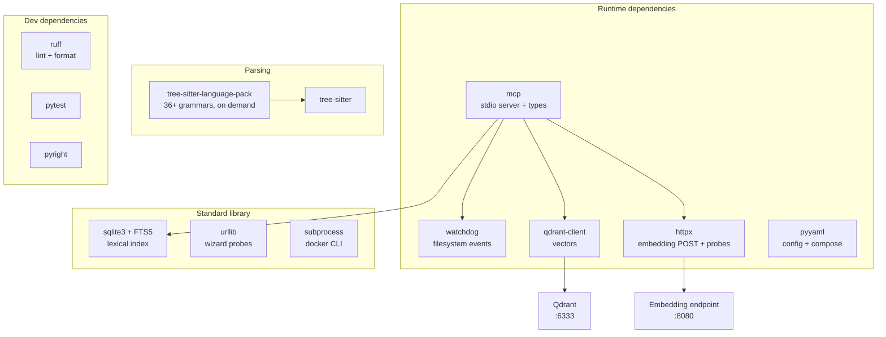

# Dependencies

## Build and Runtime

- **Language**: Python **3.12** (`requires-python = ">=3.12"`, `.python-version` pins `3.12`).
- **Packaging**: `uv_build` backend (`uv_build>=0.12.23,<0.13.0`), src-layout package at
  `src/simple_code_indexer/`.
- **Dependency manager**: `uv` only — never bare `pip` or `python -m venv`. `uv.lock` is
  committed.
- **Runtime entry point**: `simple-code-indexer = "simple_code_indexer:main"` (console script).
- **MCP SDK**: `mcp>=2.3.0` — the 2.x **constructor** handler API
  (`Server(name, on_list_tools=…, on_call_tool=…)`), *not* the removed decorator API.
- **No OpenAI client**: embeddings go through plain `httpx` to an OpenAI-compatible endpoint.

## Dependency Details

### Runtime dependencies

| Package | Constraint | Used by | Purpose |
|---|---|---|---|
| `httpx` | `>=0.28.1` | `embed.py`, `services.py` | Embedding POST with explicit timeouts; readiness probes |
| `mcp` | `>=2.3.0` | `server.py` | Official MCP SDK stdio server + `types` models |
| `pyyaml` | `>=6.0` | `configfile.py`, `setup_wizard/provision.py` | Config read/write, compose file generation |
| `qdrant-client` | `>=1.19.1` | `qdrant_store.py` | Vector collection lifecycle, upsert, query |
| `tree-sitter` | `>=0.26.0` | `parse.py` (via the pack) | Parsing runtime |
| `tree-sitter-language-pack` | `>=1.22.1` | `parse.py`, `registry.py` | 36+ grammars, downloaded on demand |
| `watchdog` | `>=6.0.0` | `watcher.py` | Native filesystem events |

### Development dependencies (`[dependency-groups].dev`)

| Package | Constraint | Purpose |
|---|---|---|
| `pyright[nodejs]` | `>=1.1.400` | Type checking (`typeCheckingMode = "standard"`, Python 3.12) |
| `pytest` | `>=8.0` | Test runner (`testpaths = ["tests"]`, `pythonpath = ["src"]`) |
| `ruff` | `>=0.12` | Lint + format (line length 88, `target-version = "py312"`) |

Ruff lint extends the defaults with `UP` (pyupgrade) and `I` (isort). `*.md` is excluded from
ruff — `docs/tdd.md` is the build contract and must not be rewritten.

## External Services

| Service | Endpoint | Client | Failure behaviour |
|---|---|---|---|
| Embeddings (llama.cpp / OpenAI-compatible) | `http://localhost:8080/v1/embeddings` | `httpx` in `embed.py` | `EmbedError` → fail-soft, `embedding_state='error'`, retried next sweep |
| Qdrant | `http://localhost:6333` | `qdrant-client` | `QdrantUnavailable` → fail-soft, `qdrant_ok: false` |
| Docker (optional) | local daemon | `subprocess` in `services.py`, `provision.py` | Managed services marked `unavailable`; the server still serves |

Both services are **optional at runtime** — lexical search (SQLite + FTS5) works with either
down. They are only mandatory for the semantic path and for a fresh setup.

The embedding endpoint's physical batch size is **512 tokens**: any single input over ~512
tokens returns HTTP 500. `embed.embed_texts` therefore splits texts into ≤1200-char pieces
(preferring line boundaries) and mean-pools the piece vectors back to one vector per input.

## Development Tools

```bash
uv sync                        # install / refresh the environment
uv run ruff check .            # lint
uv run ruff format .           # format
uv run pyright                 # typecheck (src, tests, setup.py)
uv run pytest                  # all tests
uv run pytest -p no:cacheprovider --basetemp <writable dir>   # on this host
```

Probes (run from the workspace you want indexed):

```bash
uv run python tests/service_probe.py    # embeddings + Qdrant reachability
uv run python tests/mcp_probe.py        # stdio MCP contract and tool shapes
uv run python tests/live_watch_probe.py # index-on-save latency
```

## Example Snippets

The complete dependency surface (`pyproject.toml`):

```toml
[project]
name = "simple-code-indexer"
version = "0.1.0"
requires-python = ">=3.12"
dependencies = [
    "httpx>=0.28.1",
    "mcp>=2.3.0",
    "pyyaml>=6.0",
    "qdrant-client>=1.19.1",
    "tree-sitter>=0.26.0",
    "tree-sitter-language-pack>=1.22.1",
    "watchdog>=6.0.0",
]

[project.scripts]
simple-code-indexer = "simple_code_indexer:main"

[dependency-groups]
dev = [
    "pyright[nodejs]>=1.1.400",
    "pytest>=8.0",
    "ruff>=0.12",
]

[build-system]
requires = ["uv_build>=0.12.23,<0.13.0"]
build-backend = "uv_build"
```

The embedding POST — retries, count validation and dimension validation:

```python
for attempt in range(_ATTEMPTS):          # _ATTEMPTS = 3
    try:
        response = httpx.post(
            url,
            json={"model": settings.embed_model, "input": texts},
            headers=headers,
            timeout=httpx.Timeout(settings.embed_timeout_s, connect=1.0),
        )
        response.raise_for_status()
        body = response.json()
        vectors = [item["embedding"] for item in sorted(body["data"], key=lambda i: i["index"])]
        if len(vectors) != len(texts):
            raise EmbedError(f"expected {len(texts)} vectors, got {len(vectors)}")
        if any(len(v) != settings.embed_dim for v in vectors):
            raise EmbedError(
                f"dimension mismatch: expected {settings.embed_dim}, got {len(vectors[0])}"
            )
        return vectors
    except (EmbedError, httpx.HTTPError, KeyError, IndexError, TypeError, ValueError) as exc:
        error = exc
        time.sleep(0.25 * (attempt + 1))
```

## Compatibility Notes

- **MCP SDK 2.x only.** The 1.x decorator API (`@server.list_tools`) is gone; handlers are
  constructor kwargs and model fields are snake_case.
- **Windows**: the workspace lock uses `msvcrt.locking`; POSIX uses `fcntl.flock`. Loopback
  connections to closed ports on this host take 2–4 s to fail, so the embed client caps its
  *connect* timeout at 1 s and unit tests never touch the network.
- **tree-sitter-language-pack downloads grammars on demand.** On a fresh machine only
  `['cpp','python']` are local; the rest are fetched by `get_parser`. Offline first use falls
  back to the regex symbol scan.
- **`mcp` and `qdrant-client` are imported lazily where it matters.** `qdrant_client` is
  imported inside functions (its gRPC stack is heavy); `tree_sitter_language_pack` is imported
  inside `_parser` so server startup stays under ~3 s.
- **Python 3.12 is required** for `type` statement syntax, PEP 695 generics in the type
  checker, and the `datetime.UTC` alias used by the sweep timestamp.

## Versioning Notes

- **Lower bounds only, no upper pins** for runtime deps — the lockfile (`uv.lock`) is the
  reproducible artefact; `uv sync` installs exactly what it pins.
- **The build backend is pinned tightly** (`uv_build>=0.12.23,<0.13.0`) because the backend
  API is unstable across minors.
- **The embedding dimension is a hard contract**, not a soft preference: `EMBED_DIM` must
  equal the endpoint's real vector length, and the Qdrant collection is validated against it.
  Changing the model therefore changes the dimension, hence the collection name, hence the
  whole index.
- **The MCP wire contract is version-sensitive.** Output shapes are documented in
  `docs/tdd.md` §8 and probe-tested by `tests/mcp_probe.py`; adding `outputSchema` or
  `capabilities.tasks` breaks the harness (ADR-0006).

## Diagrams



## Source References

- `pyproject.toml`
- `uv.lock`
- `.python-version`
- `setup.py`
- `src/simple_code_indexer/embed.py`
- `src/simple_code_indexer/qdrant_store.py`
- `src/simple_code_indexer/services.py`
- `src/simple_code_indexer/parse.py`
- `src/simple_code_indexer/watcher.py`
- `src/simple_code_indexer/server.py`
- `src/simple_code_indexer/setup_wizard/provision.py`
- `src/simple_code_indexer/setup_wizard/catalog.py`
- `tests/service_probe.py`
- `tests/mcp_probe.py`
- `tests/live_watch_probe.py`
- `docs/adr/0005-python-mcp-stack.md`
- `docs/adr/0006-harness-safe-mcp-surface.md`
- `NOTES.md`