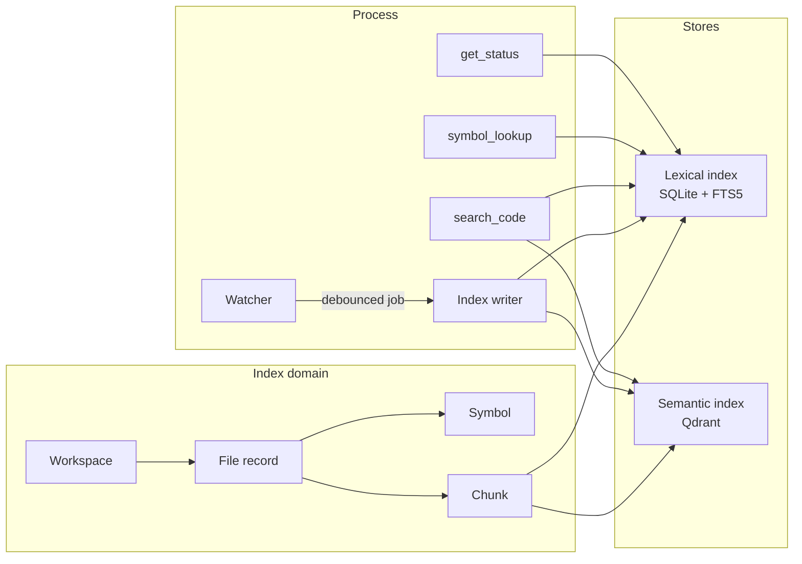

# Glossary

Canonical domain language for this repository. The upstream source of truth is
[`GLOSSARY.md`](../GLOSSARY.md); this page mirrors it with links to where each term is
implemented. Words in the *Avoid* column are the terms the project deliberately does not
use.

## Terms

The index domain — what is stored and how it is named.

| Term | Definition | Avoid | Implemented in |
|---|---|---|---|
| **Workspace** | The single root directory whose files are indexed and watched — the MCP process working directory, unless `WORKSPACE_ROOT` says otherwise | repo, repository, project root, codebase | `config.workspace_root_from_env()` |
| **File record** | The stored metadata for one indexed workspace file: path, language, size, content hash, mtime | document, entry, file entry | `models.FileRecord`, table `files` |
| **Symbol** | A named code definition extracted from a file (function, class, method, …) with kind, line range, and signature | definition, identifier, entity | `models.Symbol`, table `symbols` |
| **Chunk** | A contiguous slice of file content used for full-text indexing and embedding, bounded by start and end lines | segment, fragment, piece, passage | `models.Chunk`, table `chunks` |
| **Lexical index** | SQLite + FTS5 store over file records, symbols, and chunk text; powers BM25/keyword search | text index, full-text index, FTS index | `db.py` |
| **Semantic index** | Qdrant vector store of chunk embeddings; powers similarity search | vector index, embedding index | `qdrant_store.py` |
| **Index** (the whole) | The combined lexical index and semantic index for one workspace | database, catalog, store | both stores |
| **Index directory** | The gitignored `.simple-ci/` directory in a workspace — holds `index.db` (plus WAL and lock files) and, when the project uses a local config, `config.yaml` | data directory, cache folder, `.index` (the retired name) | `configfile.LOCAL_DIRNAME` |
| **Point ID** | Stable Qdrant point identifier derived from the indexed file path and chunk index (`uuid5(NAMESPACE_URL, f"{path}:{chunk_index}")`), so upserts are idempotent | vector ID, embedding ID | `qdrant_store.point_id` |
| **Collection name** | The Qdrant collection holding one workspace's vectors — `code_index_{folder_slug}_{sha256(path)[:8]}_{embed_dim}`, overridable with `QDRANT_COLLECTION` | namespace, index name, vector store name | `config.derive_collection_name` |
| **Index identity** | The `meta` binding of an index DB to exactly one Qdrant endpoint and collection; a mismatch drops every row so the startup reconcile re-embeds | schema version, migration marker | `db.ensure_index_identity` |

Two terms that are easy to confuse, made concrete:

```python
# Point ID -- stable per (path, chunk_index), so re-indexing replaces the point.
POINT_NAMESPACE = uuid.uuid5(uuid.NAMESPACE_URL, "simple-code-indexer")

def point_id(path: str, chunk_index: int) -> uuid.UUID:
    return uuid.uuid5(POINT_NAMESPACE, f"{path}:{chunk_index}")

# Collection name -- one per workspace, so two projects never share vectors.
def derive_collection_name(workspace_root: Path, embed_dim: int) -> str:
    digest = hashlib.sha256(
        normalize_workspace_path(workspace_root).encode("utf-8")
    ).hexdigest()[:8]
    slug = re.sub(r"[^a-z0-9]+", "-", workspace_root.resolve().name.lower())
    return f"code_index_{slug.strip('-')[:32] or 'root'}_{digest}_{embed_dim}"
```

## Search and Tools

- **search_code**: MCP tool returning ranked file/line/snippet hits for a query. May be
  lexical, semantic, or fused.
  _Avoid_: find, grep, query
- **symbol_lookup**: MCP tool resolving a symbol name to its definition site (file, line,
  kind, signature).
  _Avoid_: find_symbol, go_to_definition
- **get_status**: MCP tool reporting index health: file counts, watcher liveness, sweep age,
  external service reachability.
  _Avoid_: health, status_check, ping
- **Semantic hit**: A search result sourced from vector similarity rather than (or in
  addition to) lexical matching.
  _Avoid_: vector hit, embedding match
- **Lexical hit**: A search result sourced from FTS5 BM25 matching over chunk text.
  _Avoid_: text match, grep result
- **Reconciliation sweep**: Periodic full-tree walk that compares file metadata to the index
  and re-indexes mismatches; the backstop for dropped watch events.
  _Avoid_: full scan, hash sweep, resync, sweeper (in prose)
- **Startup reconcile**: One reconciliation sweep at process start covering changes made while
  the system was down.
  _Avoid_: cold start index, bootstrap scan

| Tool | Input | Output |
|---|---|---|
| `search_code` | `query`, `semantic`, `limit` | `{hits[], source}` |
| `symbol_lookup` | `symbol` | a flat match, or `{symbol, found, matches[]}` |
| `get_status` | — | counts, paths, service states |

## Process and Runtime

- **Index writer**: The single thread allowed to write the SQLite index and Qdrant points.
  _Avoid_: indexer process, writer, mutator
- **MCP server**: The stdio process implementing initialize / tools/list / tools/call for the
  harness.
  _Avoid_: server, MCP process, tool server
- **Watcher**: Filesystem observer that turns save/delete events into index work via a
  debounced queue.
  _Avoid_: file monitor, listener, FS watcher
- **Debounce window**: Short delay (300–500 ms) that collapses editor temp+rename bursts into
  one index job per path.
  _Avoid_: throttle, delay, cooldown
- **Index on save**: Re-indexing a file immediately when a save event is observed,
  independent of version-control state.
  _Avoid_: live indexing, hot reload, auto-sync
- **All-in-one topology**: One host process per harness session hosts both the MCP stdio
  server and the watcher/writer. Shipped default.
  _Avoid_: embedded mode, combined mode
- **Sidecar topology**: Always-on watcher/indexer service with a separate read-only MCP query
  process. Post-MVP option.
  _Avoid_: daemon mode, split mode, background mode
- **Managed service**: A Docker container named in `config.yaml` (`embedding.service` /
  `qdrant.service`) that the MCP server starts and waits for at boot. Fail-soft: an
  unavailable service degrades to lexical-only search instead of blocking the session.
  _Avoid_: sidecar, dependency, docker service (in prose)
- **Workspace lock**: The OS advisory lease on `<index.db>.lock` that enforces one index
  writer per workspace.
  _Avoid_: mutex, lockfile (it is a lease, not a lock file)

## Configuration and Plugins

- **Config file**: Optional `config.yaml` read at server startup:
  `<workspace>/.simple-ci/config.yaml` first, then `~/.simple-ci/config.yaml`. Environment
  variables override both. Records the embedding endpoint/model/dimension, the Qdrant URL,
  and any Docker services the server should start.
  _Avoid_: settings, preferences, env file
- **Harness**: An MCP client host (Claude Code, Codex, OpenCode, MiMoCode, and others) that
  spawns the server over stdio — with the session's project as its working directory — and
  loads tools from its own config file.
  _Avoid_: client, IDE, agent host
- **Harness plugin**: A module in `src/simple_code_indexer/harnesses/` (or a user override in
  `<repo>/harnesses/` or `<workspace>/harnesses/`) that declares one harness's detection
  folders, global/project config paths, and how to merge a server entry into its file.
  Overrides a builtin by `NAME`.
  _Avoid_: adapter, integration, connector
- **Language plugin**: A module in `src/simple_code_indexer/builtin/` (or a user override in
  `<repo>/plugins/` or `<workspace>/plugins/`) declaring a language id, a tree-sitter
  grammar, the extensions/filenames it claims, optional symbol node maps and an optional
  specialized extractor.
  _Avoid_: grammar pack entry, language support module
- **Setup wizard**: The interactive flow started by `python setup.py`: installs `uv`, chooses
  an embedding endpoint (existing or downloaded), provisions Qdrant, probes the vector
  dimension, registers the server with detected harnesses, and writes `config.yaml`.
  _Avoid_: installer, bootstrap, setup script (as a noun for the logic)
- **Allowlist**: The set of file extensions and exact filenames the indexer will read,
  derived from the loaded language plugins (`Settings.allowed_exts`,
  `Settings.allowed_filenames`).
  _Avoid_: include list, glob set

## Diagrams



## Source References

- `GLOSSARY.md`
- `src/simple_code_indexer/models.py`
- `src/simple_code_indexer/config.py`
- `src/simple_code_indexer/configfile.py`
- `src/simple_code_indexer/db.py`
- `src/simple_code_indexer/embed.py`
- `src/simple_code_indexer/qdrant_store.py`
- `src/simple_code_indexer/parse.py`
- `src/simple_code_indexer/registry.py`
- `src/simple_code_indexer/indexer.py`
- `src/simple_code_indexer/watcher.py`
- `src/simple_code_indexer/workspace_lock.py`
- `src/simple_code_indexer/services.py`
- `src/simple_code_indexer/server.py`
- `src/simple_code_indexer/harnesses/__init__.py`
- `src/simple_code_indexer/setup_wizard/__init__.py`
- `docs/tdd.md`