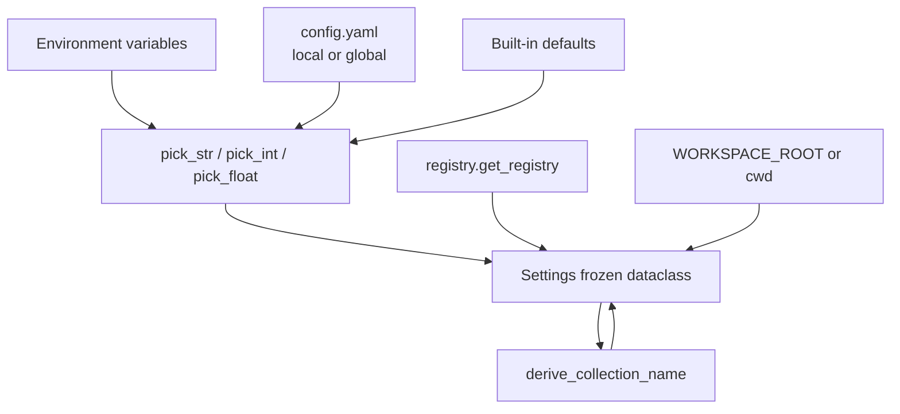

# Module: Settings and Configuration

Two modules cooperate here:

- **`configfile.py`** — *discovery and parsing* of the layered `config.yaml`: which file wins,
  how it is read, how it is written, and typed getters that raise `ConfigError` on the wrong
  type.
- **`config.py`** — *resolution* into a frozen `Settings` dataclass, applying environment
  overrides and deriving the workspace, index path and Qdrant collection name.

## Responsibilities

- Resolve the **workspace**: `WORKSPACE_ROOT` if set, else the process cwd.
- Discover the **config file** in the documented order and expose its path as
  `Settings.config_source`.
- Merge **file values and environment variables** into one immutable `Settings`.
- Derive the **Qdrant collection name** from the workspace path and the vector dimension.
- Own the **allowlist policy**: ignore directories, temp-file names, and the
  extension/filename allowlist derived from the plugin registry.

## Key Files

| Path | Purpose |
|---|---|
| `src/simple_code_indexer/config.py` | `Settings`, `ManagedService`, `load_settings`, allowlist helpers |
| `src/simple_code_indexer/configfile.py` | Discovery, YAML load/write, typed getters |
| `src/simple_code_indexer/setup_wizard/write.py` | Writes the config the wizard produces |
| `src/simple_code_indexer/setup_wizard/provision.py` | Generates the compose file referenced by `service` blocks |

## Public Interfaces

| Name | Kind | Description |
|---|---|---|
| `load_settings() -> Settings` | function | The single entry point |
| `Settings` | frozen dataclass | 17 fields; `slots=True` |
| `ManagedService` | frozen dataclass | `container`, `compose_file`, `compose_service`, `startup_timeout_s` |
| `configfile.find_config_file(workspace_root, home=None) -> Path\|None` | function | Discovery |
| `configfile.load_config(path) -> dict` | function | YAML → mapping |
| `configfile.write_config(data, path)` | function | Atomic YAML write, `0600` on POSIX |
| `configfile.get_mapping / get_str / get_int / get_float` | functions | Typed getters that raise `ConfigError` |
| `is_allowed(settings, path) -> bool` | function | Extension **or** exact filename match |
| `is_temp_name(name) -> bool` | function | Editor temp-name detection |
| `derive_collection_name(workspace_root, embed_dim) -> str` | function | The per-workspace collection name |
| `workspace_root_from_env() -> Path` | function | `WORKSPACE_ROOT` else `Path.cwd().resolve()` |
| `normalize_workspace_path(workspace_root) -> str` | function | Resolved, lowercased, forward-slash hash input |
| `IGNORE_DIRS` | constant | `.git`, `.index`, `.simple-ci`, `__pycache__`, `.venv`, `node_modules` |

## Inputs and Outputs

| Type | Name | Location | Description |
| --- | --- | --- | --- |
| Input | Environment | process env | Every `*_URL`, `*_MODEL`, `*_DIM`, `*_SECONDS` override |
| Input | Local config | `<workspace>/.simple-ci/config.yaml` | Highest-priority file |
| Input | Global config | `~/.simple-ci/config.yaml` | Fallback file |
| Input | Plugin registry | `registry.get_registry()` | Supplies the allowlists |
| Output | `Settings` | `load_settings()` | The immutable runtime configuration |
| Output | Config path | `Settings.config_source` | `None` when no file exists — reported by `get_status` |

## Configuration

### Precedence (highest first)

1. Environment variable
2. `<workspace>/.simple-ci/config.yaml`
3. `~/.simple-ci/config.yaml`
4. Built-in default

`SIMPLE_CI_CONFIG` short-circuits discovery: an explicit path is used as-is; the values
`none` / `off` disable discovery entirely (the test suite sets `none`).

### `Settings` fields

| Field | Env | Default | Source |
|---|---|---|---|
| `workspace_root` | `WORKSPACE_ROOT` | `Path.cwd().resolve()` | env |
| `index_db_path` | `INDEX_DB` | `<workspace>/.simple-ci/index.db` | env |
| `qdrant_url` | `QDRANT_URL` | `http://localhost:6333` | file → env → default |
| `qdrant_collection` | `QDRANT_COLLECTION` | derived per workspace | file → env → derived |
| `embed_base_url` | `EMBED_BASE_URL` | `http://localhost:8080` | file → env → default |
| `embed_model` | `EMBED_MODEL` | `Qwen3-Embedding-4B-Q6_K` | file → env → default |
| `embed_dim` | `EMBED_DIM` | `2560` | file → env → default |
| `embed_timeout_s` | `EMBED_TIMEOUT_S` | `15.0` | file → env → default |
| `embed_api_key` | `EMBED_API_KEY` | `None` | file → env |
| `sweep_seconds` | `SWEEP_SECONDS` | `45.0` | file → env → default |
| `debounce_ms` | `DEBOUNCE_MS` | `400` | file → env → default |
| `allowed_exts` | — | from the registry | derived |
| `allowed_filenames` | — | from the registry | derived |
| `ignore_dirs` | — | `IGNORE_DIRS` | constant |
| `embedding_service` | — | `None` | `embedding.service` block |
| `qdrant_service` | — | `None` | `qdrant.service` block |
| `config_source` | — | `None` | the discovered file |

## Example Snippets

The collection name derivation:

```python
def derive_collection_name(workspace_root: Path, embed_dim: int) -> str:
    """Per-workspace Qdrant collection: readable slug + path hash + vector dim."""
    digest = hashlib.sha256(
        normalize_workspace_path(workspace_root).encode("utf-8")
    ).hexdigest()[:8]
    slug = re.sub(r"[^a-z0-9]+", "-", workspace_root.resolve().name.lower())
    return f"code_index_{slug.strip('-')[:32] or 'root'}_{digest}_{embed_dim}"
```

Discovery with the `SIMPLE_CI_CONFIG` escape hatch:

```python
def find_config_file(workspace_root: Path, home: Path | None = None) -> Path | None:
    explicit = os.environ.get("SIMPLE_CI_CONFIG")
    if explicit is not None:
        if explicit.strip().lower() in _DISABLED_VALUES:
            return None
        path = Path(explicit).expanduser()
        if path.is_file():
            return path
        logger.warning("SIMPLE_CI_CONFIG points at a missing file: %s", path)
        return None
    local = workspace_root / LOCAL_DIRNAME / CONFIG_FILENAME
    if local.is_file():
        return local
    global_config = (home or Path.home()) / LOCAL_DIRNAME / CONFIG_FILENAME
    if global_config.is_file():
        return global_config
    return None
```

A `service` block, parsed into a `ManagedService`:

```python
def _managed_service(section: dict[str, Any], where: str) -> ManagedService | None:
    raw = section.get("service")
    if raw is None:
        return None
    if not isinstance(raw, dict):
        raise ConfigError(f"'{where}.service' must be a mapping")
    container = raw.get("container")
    if not isinstance(container, str) or not container:
        raise ConfigError(f"'{where}.service.container' must be a non-empty string")
    ...
    timeout = raw.get("startup_timeout_s", 45.0)
    if isinstance(timeout, bool) or not isinstance(timeout, (int, float)):
        raise ConfigError(f"'{where}.service.startup_timeout_s' must be a number")
    return ManagedService(container=container, compose_file=compose_file,
                          compose_service=compose_service, startup_timeout_s=float(timeout))
```

The allowlist decision — extension **or** exact filename:

```python
def is_allowed(settings: Settings, path: Path) -> bool:
    """True when the path matches a plugin extension or exact filename."""
    return (
        path.name in settings.allowed_filenames
        or path.suffix.lower() in settings.allowed_exts
    )
```

## Edge Cases

- **Missing config file** → defaults are used; `Settings.config_source` is `None` and
  `get_status.config_file` is `null`.
- **`SIMPLE_CI_CONFIG=none`** → discovery is skipped entirely.
- **`SIMPLE_CI_CONFIG` points at a missing file** → a warning is logged and discovery stops
  (it does *not* fall through to the local/global file).
- **Wrong YAML type** (e.g. `embedding.dim: "2560"`) → `ConfigError` with the offending path.
- **Non-mapping YAML root** → `ConfigError("config … must contain a mapping")`.
- **Unknown config `version`** → a warning is logged; the build still proceeds.
- **Empty YAML file** → `{}` — all defaults.
- **Boolean passed where an int is expected** → `ConfigError` (bools are not ints here).
- **Non-numeric `EMBED_DIM`** → `ConfigError("EMBED_DIM must be an integer, got …")`.
- **Case-sensitive paths** → the collection hash is lowercased, so `/x/App` and `/x/app`
  collapse onto one collection (deliberate).
- **Empty folder name** → the slug falls back to `root`.
- **`Path("Dockerfile").suffix` is empty** → exact-filename matching is required; `.suffix`
  alone cannot express `Dockerfile`, `CMakeLists.txt` or `.vimrc`.

## Diagrams



## Tests

- `tests/test_config.py` — env overrides, defaults, collection derivation, allowlist rules.
- `tests/test_configfile.py` — discovery order, `SIMPLE_CI_CONFIG`, typed getters, atomic write.
- `tests/conftest.py` — the autouse fixture that sets `SIMPLE_CI_CONFIG=none`.

## Source References

- `src/simple_code_indexer/config.py`
- `src/simple_code_indexer/configfile.py`
- `src/simple_code_indexer/registry.py`
- `src/simple_code_indexer/setup_wizard/write.py`
- `src/simple_code_indexer/setup_wizard/provision.py`
- `src/simple_code_indexer/setup_wizard/__init__.py`
- `src/simple_code_indexer/server.py`
- `src/simple_code_indexer/indexer.py`
- `tests/test_config.py`
- `tests/test_configfile.py`
- `tests/conftest.py`
- `docs/adr/0009-setup-wizard-managed-services-config.md`
- `docs/tdd.md`