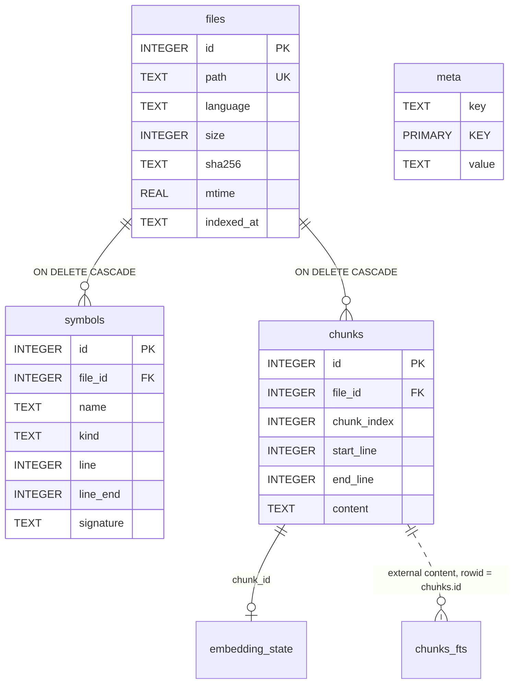

# Module: Lexical Store (db)

## Responsibilities

- Owns the **SQLite schema**: `files`, `symbols`, `chunks`, the external-content FTS5 mirror
  `chunks_fts`, `embedding_state` and the `meta` identity table.
- Provides the **connection policy**: WAL mode, `busy_timeout=5000`, `foreign_keys=ON`, row
  factory, and a read-only mode for the MCP query path.
- Implements the **lexical queries**: BM25 full-text search over chunks, exact-then-prefix
  symbol lookup, row statistics.
- Implements the **identity binding**: `ensure_index_identity` drops rows that belong to a
  different Qdrant endpoint or collection.
- Keeps `chunks` and `chunks_fts` in sync through **triggers**, never manual copies.

## Key Files

| Path | Purpose |
|---|---|
| `src/simple_code_indexer/db.py` | Schema, connection helper, all SQL |
| `src/simple_code_indexer/indexer.py` | The only writer that calls the write helpers |
| `src/simple_code_indexer/server.py` | The only reader outside the writer (read-only connections) |

## Public Interfaces

| Name | Kind | Description |
|---|---|---|
| `connect(db_path, *, readonly=False)` | context manager | WAL connection; `readonly` opens `mode=ro` |
| `ensure_schema(conn)` | function | Idempotent `executescript` of the schema |
| `upsert_file(conn, record) -> int` | function | Insert-or-update the file row; returns `file_id` |
| `file_hash(conn, path) -> str\|None` | function | The stored sha256, used by the short-circuit |
| `replace_file_symbols(conn, file_id, symbols)` | function | Delete + reinsert a file's symbols |
| `replace_file_chunks(conn, file_id, chunks)` | function | Delete + reinsert a file's chunks |
| `delete_file(conn, path)` | function | Delete by path; FK cascade removes the children |
| `fts_search(conn, query, limit) -> list[SearchHit]` | function | BM25 search with snippets |
| `symbol_lookup(conn, name) -> list[Symbol]` | function | Exact match, then `LIKE 'name%'` |
| `stats(conn) -> dict[str, int]` | function | `files` / `symbols` / `chunks` counts |
| `chunk_ids_for_path(conn, path)` | function | `(chunk_id, chunk_index)` pairs |
| `record_embedding_state(conn, rows)` | function | Upsert the observability rows |
| `chunks_needing_embedding(conn)` | function | Rows with no `ok` embedding state |
| `get_meta` / `set_meta` | functions | The identity key/value store |
| `ensure_index_identity(conn, *, qdrant_url, collection) -> bool` | function | Bind or invalidate the index |
| `get_chunk(conn, path, chunk_index) -> ChunkSpan\|None` | function | One chunk's line range and content |
| `ChunkSpan` | NamedTuple | `start_line`, `end_line`, `content` |

## Inputs and Outputs

| Type | Name | Location | Description |
| --- | --- | --- | --- |
| Input | SQL parameters | call sites | Paths, hashes, symbol tuples, chunk tuples |
| Input | FTS match expression | `fts_search` | `"tok" OR "tok"` built from `\w+` tokens |
| Output | SQLite connection | `<workspace>/.simple-ci/index.db` | WAL database with the FTS5 virtual table |
| Output | `SearchHit` list | `fts_search` | path, line, end_line, snippet, score, source |
| Output | `Symbol` list | `symbol_lookup` | name, kind, line, line_end, signature, path, language |
| Output | `ChunkSpan` | `get_chunk` | Used to map a Qdrant point back to line numbers |

## Configuration

- `Settings.index_db_path` — where the file lives (default `<workspace>/.simple-ci/index.db`).
- `PRAGMA journal_mode=WAL` — set on every writable connection.
- `PRAGMA busy_timeout=5000` — readers never block long behind the writer.
- `PRAGMA foreign_keys=ON` — the cascade is what removes symbols/chunks for a deleted file.
- `tokenize='unicode61'` — the FTS5 tokenizer; queries are plain word tokens.

## Example Snippets

The schema (abridged to the parts that carry the design):

```sql
CREATE TABLE IF NOT EXISTS files (
  id INTEGER PRIMARY KEY, path TEXT NOT NULL UNIQUE, language TEXT NOT NULL,
  size INTEGER NOT NULL, sha256 TEXT NOT NULL, mtime REAL NOT NULL, indexed_at TEXT NOT NULL
);
CREATE TABLE IF NOT EXISTS symbols (
  id INTEGER PRIMARY KEY,
  file_id INTEGER NOT NULL REFERENCES files(id) ON DELETE CASCADE,
  name TEXT NOT NULL, kind TEXT NOT NULL, line INTEGER NOT NULL,
  line_end INTEGER, signature TEXT
);
CREATE TABLE IF NOT EXISTS chunks (
  id INTEGER PRIMARY KEY,
  file_id INTEGER NOT NULL REFERENCES files(id) ON DELETE CASCADE,
  chunk_index INTEGER NOT NULL, start_line INTEGER NOT NULL, end_line INTEGER NOT NULL,
  content TEXT NOT NULL, UNIQUE(file_id, chunk_index)
);
CREATE VIRTUAL TABLE IF NOT EXISTS chunks_fts USING fts5(
  content, content='chunks', content_rowid='id', tokenize='unicode61'
);
CREATE TRIGGER IF NOT EXISTS chunks_ai AFTER INSERT ON chunks BEGIN
  INSERT INTO chunks_fts(rowid, content) VALUES (new.id, new.content);
END;
```

The identity binding — the reason rows are dropped when the collection changes:

```python
def ensure_index_identity(conn, *, qdrant_url: str, collection: str) -> bool:
    stored = (get_meta(conn, _QDRANT_URL_KEY), get_meta(conn, _COLLECTION_KEY))
    if stored == (qdrant_url, collection):
        return False
    has_rows = conn.execute("SELECT EXISTS(SELECT 1 FROM files)").fetchone()
    invalidated = stored != (None, None) or bool(has_rows[0])
    if invalidated:
        conn.execute("DELETE FROM files")  # cascades symbols/chunks/embedding_state
    set_meta(conn, _QDRANT_URL_KEY, qdrant_url)
    set_meta(conn, _COLLECTION_KEY, collection)
    return invalidated
```

The FTS query with a highlighted snippet:

```sql
SELECT c.start_line AS start_line, c.end_line AS end_line, f.path AS path,
       bm25(chunks_fts) AS rank,
       snippet(chunks_fts, 0, '', '', '…', 12) AS snip
FROM chunks_fts
JOIN chunks c ON c.id = chunks_fts.rowid
JOIN files f ON f.id = c.file_id
WHERE chunks_fts MATCH ?
ORDER BY rank
LIMIT ?
```

## Edge Cases

- **Empty or punctuation-only query** → `_fts_match_expression` returns `None` → empty result
  list, no SQL executed.
- **Query with special characters** → the regex keeps only `\w+` tokens and quotes each one,
  so FTS5 operators (`*`, `NEAR`, `-`) cannot leak into the MATCH expression.
- **Prefix symbol lookup** → `%` and `_` in the input are escaped with `ESCAPE '\'`.
- **Symbol deleted with its file** → the FK cascade removes it; `symbol_lookup` returns `[]`.
- **Rows written before the `meta` keys existed** → treated as stale and dropped.
- **Read-only connection** → opened with `file:...?mode=ro`; a write attempt raises rather than
  silently creating the file.
- **Concurrent reader vs. writer** → WAL lets readers proceed; `busy_timeout=5000` absorbs
  short write locks.
- **FTS index drift** → impossible by construction: three triggers mirror every insert,
  update and delete.

## Diagrams



## Tests

- `tests/test_db.py` — schema creation, upsert/delete, FTS hit shape, symbol lookup,
  hash short-circuit support, statistics.
- `tests/test_indexer.py` — exercises the write path end to end against a real DB.
- `tests/test_multi_workspace_isolation.py` — two workspaces, two DBs, no cross-hits.

## Source References

- `src/simple_code_indexer/db.py`
- `src/simple_code_indexer/indexer.py`
- `src/simple_code_indexer/server.py`
- `src/simple_code_indexer/models.py`
- `src/simple_code_indexer/config.py`
- `src/simple_code_indexer/workspace_lock.py`
- `tests/test_db.py`
- `tests/test_indexer.py`
- `docs/adr/0004-single-writer-sqlite-wal.md`
- `docs/tdd.md`