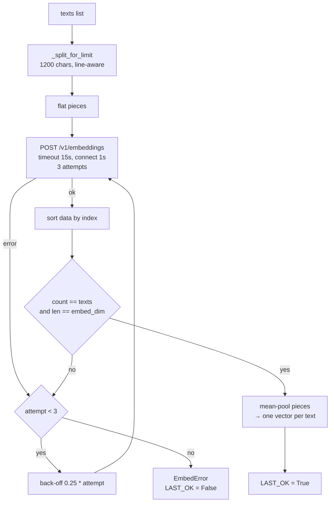

# Module: Embeddings Client

## Responsibilities

- Talks to an **OpenAI-compatible** embedding endpoint (`POST {base}/v1/embeddings`) with an
  optional bearer token.
- Guarantees **one vector per input text**, even when the text exceeds the endpoint's
  physical batch size: oversized texts are split at line boundaries and their piece vectors
  are mean-pooled.
- Validates the response: the vector count must match the request, and every vector's length
  must equal `Settings.embed_dim`.
- Retries transient failures (3 attempts, linear back-off) and reports health through the
  `LAST_OK` flag read by `get_status`.

## Key Files

| Path | Purpose |
|---|---|
| `src/simple_code_indexer/embed.py` | The whole client: split, post, pool, validate |
| `src/simple_code_indexer/indexer.py` | Calls `embed_texts` on the write path |
| `src/simple_code_indexer/server.py` | Calls `embed_query` on the semantic search path |

## Public Interfaces

| Name | Kind | Description |
|---|---|---|
| `embed_texts(settings, texts) -> list[list[float]]` | function | One vector per input text |
| `embed_query(settings, text) -> list[float]` | function | `embed_texts([text])[0]` — the query path |
| `_split_for_limit(text, limit=1200) -> list[str]` | function | Split at line boundaries under a char budget |
| `_post_embeddings(settings, texts)` | function | The retrying HTTP call + validation |
| `LAST_OK` | module global | `True` / `False` / `None` — read by `get_status.embed_ok` |

## Inputs and Outputs

| Type | Name | Location | Description |
| --- | --- | --- | --- |
| Input | Chunk texts | `indexer._embed_and_store` | The chunk contents to embed |
| Input | Query text | `server._semantic_hits` | The search phrase to embed |
| Input | Endpoint | `Settings.embed_base_url` | `{base}/v1/embeddings` |
| Input | Model | `Settings.embed_model` | Sent as the `model` field |
| Input | API key | `Settings.embed_api_key` | Optional `Authorization: Bearer` header |
| Output | Vectors | return value | `list[list[float]]`, one per input text |
| Output | Health flag | `embed.LAST_OK` | Consumed by `get_status` |

## Configuration

| Setting | Env | Default | Effect |
|---|---|---|---|
| `embed_base_url` | `EMBED_BASE_URL` | `http://localhost:8080` | `/v1/embeddings` is appended |
| `embed_model` | `EMBED_MODEL` | `Qwen3-Embedding-4B-Q6_K` | Sent as `model` |
| `embed_dim` | `EMBED_DIM` | `2560` | Every vector must be exactly this long |
| `embed_timeout_s` | `EMBED_TIMEOUT_S` | `15.0` | Read timeout; **connect timeout is capped at 1 s** |
| `embed_api_key` | `EMBED_API_KEY` | unset | Bearer token; also `embedding.api_key` in YAML |

## Example Snippets

The split-and-pool rule that keeps a 512-token llama.cpp batch limit:

```python
_SAFE_CHARS = 1200   # 512 tokens of Qwen tokenizer over dense code stays under ~1300 chars

def _split_for_limit(text: str, limit: int = _SAFE_CHARS) -> list[str]:
    if len(text) <= limit:
        return [text]
    pieces: list[str] = []
    start = 0
    while start < len(text):
        end = min(start + limit, len(text))
        if end < len(text):
            cut = text.rfind("\n", start + limit // 2, end)
            if cut != -1:
                end = cut + 1
        piece = text[start:end]
        if piece.strip():
            pieces.append(piece)
        start = end
    return pieces or [text[:limit]]
```

Mean-pooling the pieces back to one vector per text:

```python
groups = [_split_for_limit(text) for text in texts]
flat = [piece for group in groups for piece in group]
vectors = _post_embeddings(settings, flat)
pooled: list[list[float]] = []
index = 0
for group in groups:
    group_vectors = vectors[index : index + len(group)]
    index += len(group)
    if len(group_vectors) == 1:
        pooled.append(group_vectors[0])
    else:
        pooled.append([sum(values) / len(values) for values in zip(*group_vectors)])
LAST_OK = True
return pooled
```

The request itself:

```python
url = settings.embed_base_url.rstrip("/") + "/v1/embeddings"
payload = {"model": settings.embed_model, "input": texts}
headers = {"Authorization": f"Bearer {settings.embed_api_key}"} if settings.embed_api_key else {}
response = httpx.post(
    url, json=payload, headers=headers,
    timeout=httpx.Timeout(settings.embed_timeout_s, connect=1.0),
)
```

## Edge Cases

- **Empty input list** → returns `[]` without an HTTP call.
- **Text longer than the budget** → split at the last newline in the upper half; empty
  pieces are dropped; if every piece is blank the first 1200 chars are used as a fallback.
- **Vector count mismatch** → `EmbedError("expected N vectors, got M")`, retried.
- **Dimension mismatch** → `EmbedError("dimension mismatch: expected X, got Y")`; the
  collection is never written with the wrong size.
- **Endpoint down** → 3 attempts with 0.25 s / 0.5 s back-off, then `EmbedError`; `LAST_OK`
  is set to `False`.
- **Slow endpoint** → the read timeout is `embed_timeout_s`; the connect timeout is 1 s so a
  closed port fails fast (loopback to a closed port takes 2–4 s to fail on this host).
- **Malformed response** (missing `data`, missing `index`, non-list embeddings) → `KeyError`,
  `IndexError`, `TypeError` are all caught and retried.
- **Out-of-order response** → the `data` array is sorted by `index` before use.

## Diagrams



## Tests

- `tests/test_embed.py` — split behaviour, pooling, retry, count and dimension validation,
  and the `LAST_OK` transitions.
- `tests/test_indexer.py` — stubs `embed.embed_texts` so unit tests never touch the network.
- `tests/service_probe.py` — the live check of dimension and reachability.

## Source References

- `src/simple_code_indexer/embed.py`
- `src/simple_code_indexer/indexer.py`
- `src/simple_code_indexer/server.py`
- `src/simple_code_indexer/config.py`
- `src/simple_code_indexer/errors.py`
- `src/simple_code_indexer/setup_wizard/probe.py`
- `src/simple_code_indexer/setup_wizard/catalog.py`
- `tests/test_embed.py`
- `tests/service_probe.py`
- `docs/tdd.md`
- `NOTES.md`