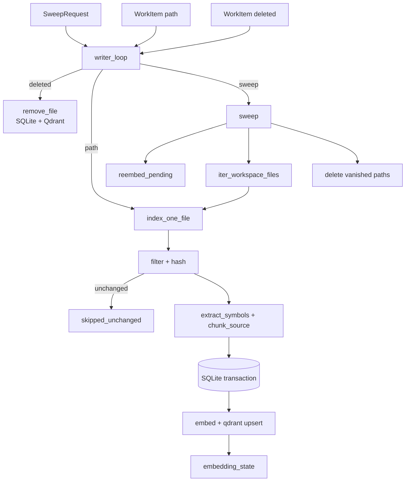

# Module: Indexer

## Responsibilities

- **The unit of work**: `index_one_file` — filter, hash, parse, chunk, write SQLite, embed,
  write Qdrant, record embedding state.
- **The backstop**: `sweep` — a full-tree walk that re-indexes drift, deletes vanished paths
  and retries failed embeddings.
- **The single writer**: `writer_loop` — the only thread allowed to mutate the index; it
  consumes work items, tombstones and sweep requests from one bounded queue.
- **Embedding recovery**: `reembed_pending` — re-embeds chunks whose embedding failed,
  independent of the hash/mtime short circuits.
- **Path relativisation**: `_relative` — every stored path is workspace-relative POSIX.

## Key Files

| Path | Purpose |
|---|---|
| `src/simple_code_indexer/indexer.py` | The whole module: work item, sweep, writer loop |
| `src/simple_code_indexer/watcher.py` | Produces the `WorkItem`s this module consumes |
| `src/simple_code_indexer/server.py` | Starts the writer thread and enqueues the startup sweep |

## Public Interfaces

| Name | Kind | Description |
|---|---|---|
| `index_one_file(settings, path) -> IndexOutcome` | function | Index one file; the hash short-circuit lives here |
| `sweep(settings) -> SweepStats` | function | Full reconciliation pass |
| `reembed_pending(settings) -> int` | function | Retry failed embeddings; returns files healed |
| `remove_file(settings, path)` | function | Tombstone handling: delete rows + vectors |
| `writer_loop(settings, work_queue)` | function | The consumer thread; never returns |
| `iter_workspace_files(settings) -> Iterator[Path]` | function | Pruned, allowlisted workspace walk |
| `new_work_queue(maxsize=500) -> WorkQueue` | function | The bounded queue factory |
| `WorkItem(path, deleted=False)` | dataclass | Frozen queue item |
| `SweepRequest` / `SWEEP_REQUEST` | class / sentinel | Queue marker for a sweep |
| `IndexOutcome` | NamedTuple | `path`, `status`, `duration_ms` |
| `SweepStats` | NamedTuple | `checked`, `indexed`, `unchanged`, `removed`, `errors` |
| `LAST_SWEEP` | module global | UTC ISO timestamp of the last completed sweep |

### Outcome statuses

| Status | Meaning |
|---|---|
| `indexed` | The file was parsed and stored |
| `skipped_unchanged` | The stored sha256 matched the file bytes |
| `skipped_filtered` | Outside the allowlist, a temp name, or in an ignored directory |
| `error` | The file could not be read, parsed or written |

## Inputs and Outputs

| Type | Name | Location | Description |
| --- | --- | --- | --- |
| Input | Work queue | `indexer.WorkQueue` | `WorkItem` values and `SWEEP_REQUEST` sentinels |
| Input | Workspace tree | filesystem | The set of allowlisted files to reconcile against |
| Input | Settings | `config.Settings` | Workspace root, ignore dirs, endpoints |
| Output | File rows | `files` table | path, language, size, sha256, mtime, indexed_at |
| Output | Symbol rows | `symbols` table | Replaced wholesale per file |
| Output | Chunk rows | `chunks` table (+ FTS mirror) | Replaced wholesale per file |
| Output | Vectors | Qdrant collection | One point per chunk, keyed by stable point ID |
| Output | Embedding state | `embedding_state` table | `ok` / `error` per chunk |
| Output | Sweep stamp | `LAST_SWEEP` | Read by `get_status.last_sweep` |

## Configuration

- `Settings.workspace_root` — the only tree that is indexed.
- `Settings.ignore_dirs` — `.git`, `.index`, `.simple-ci`, `__pycache__`, `.venv`,
  `node_modules` (`config.IGNORE_DIRS`).
- `Settings.allowed_exts` / `allowed_filenames` — derived from the plugin registry.
- `Settings.debounce_ms`, `Settings.sweep_seconds` — owned by the watcher / sweep timer.
- `Settings.embed_*`, `Settings.qdrant_*` — used by the embed + Qdrant steps.

## Example Snippets

The hash short-circuit and the single write transaction:

```python
digest = hashlib.sha256(data).hexdigest()
source = data.decode("utf-8", errors="replace")
try:
    with db.connect(settings.index_db_path) as conn:
        db.ensure_schema(conn)
        if db.file_hash(conn, rel) == digest:
            return done("skipped_unchanged")
        record = FileRecord(
            path=rel,
            language=parse.detect_language(path) or "text",
            size=len(data),
            sha256=digest,
            mtime=path.stat().st_mtime,
        )
        symbols = parse.extract_symbols(path, source)
        chunks = parse.chunk_source(source)
        with conn:
            file_id = db.upsert_file(conn, record)
            db.replace_file_symbols(conn, file_id, symbols)
            db.replace_file_chunks(conn, file_id, chunks)
    _embed_and_store(settings, rel, chunks)
    return done("indexed")
except (sqlite3.Error, OSError, ValueError):
    logger.exception("failed to index %s", path)
    return done("error")
```

The pruned workspace walk — the reason `rglob` is forbidden:

```python
def iter_workspace_files(settings: Settings) -> Iterator[Path]:
    """Yield allowlisted files, pruning ignored dirs (rglob would walk .venv)."""
    root = settings.workspace_root
    for dirpath, dirnames, filenames in os.walk(root, topdown=True):
        dirnames[:] = [d for d in dirnames if d not in settings.ignore_dirs]
        for name in filenames:
            if is_temp_name(name):
                continue
            path = Path(dirpath) / name
            if is_allowed(settings, path):
                yield path
```

Embedding with a fail-soft status record:

```python
def _embed_and_store(settings, rel, chunks) -> bool:
    if not chunks:
        return True
    points = {c.chunk_index: str(qdrant_store.point_id(rel, c.chunk_index)) for c in chunks}
    status = "ok"
    try:
        vectors = embed.embed_texts(settings, [c.content for c in chunks])
        try:
            qdrant_store.upsert_chunks(settings, rel, list(zip(chunks, vectors)))
        except QdrantUnavailable:
            status = "error"
            logger.warning("qdrant upsert failed for %s", rel, exc_info=True)
    except EmbedError:
        status = "error"
        logger.warning("embedding failed for %s", rel, exc_info=True)
    with db.connect(settings.index_db_path) as conn, conn:
        rows = [
            (chunk_id, points[chunk_index], status)
            for chunk_id, chunk_index in db.chunk_ids_for_path(conn, rel)
            if chunk_index in points
        ]
        db.record_embedding_state(conn, rows)
    return status == "ok"
```

## Edge Cases

- **Path outside the workspace** → `_relative` returns `None` → `skipped_filtered`.
- **Unreadable file** → `OSError` on `read_bytes` → outcome `error`, the walk continues.
- **File vanished mid-sweep** → `OSError` on `path.stat()` → skipped this pass; the stale row
  is removed on the next one.
- **Directory removed from disk** → `db.delete_file` cascades to symbols, chunks and
  embedding state; the FTS triggers keep `chunks_fts` aligned.
- **Qdrant delete fails** → logged; orphan points are harmless because semantic hits are
  re-checked against SQLite.
- **Embedding service down** → the chunk is stored lexically with `status='error'`.
- **Re-embedding stops early** — `reembed_pending` breaks at the first failing file so a down
  endpoint costs one retry per sweep, not one per file.
- **Queue overflow** → the item is dropped by the watcher; the sweep recovers it.
- **`writer_loop` catches everything** — a failing item is logged and the loop continues, so
  one bad file never kills the writer.

## Diagrams



## Tests

- `tests/test_indexer.py` — end-to-end index, hash short-circuit, re-embed after failure,
  re-embed stops at the first failing file, filtered/missing files, ignored-dir pruning,
  drift detection and deleted-file removal.
- `tests/test_db.py` — the storage side of every operation the indexer performs.
- `tests/test_watcher.py` — the producer side of the queue contract.

## Source References

- `src/simple_code_indexer/indexer.py`
- `src/simple_code_indexer/watcher.py`
- `src/simple_code_indexer/server.py`
- `src/simple_code_indexer/db.py`
- `src/simple_code_indexer/embed.py`
- `src/simple_code_indexer/qdrant_store.py`
- `src/simple_code_indexer/parse.py`
- `src/simple_code_indexer/config.py`
- `src/simple_code_indexer/models.py`
- `src/simple_code_indexer/errors.py`
- `tests/test_indexer.py`
- `docs/adr/0001-index-on-save-not-git-state.md`
- `docs/tdd.md`