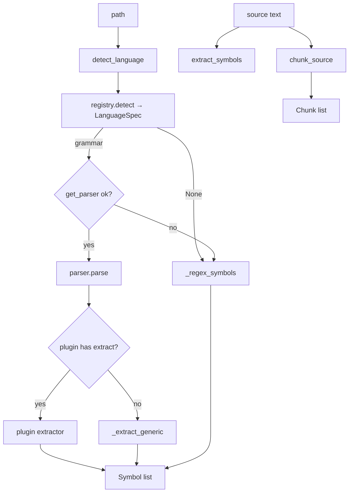

# Module: Parser and Chunking

## Responsibilities

- Maps a file path to a **plugin language** (`detect_language`).
- Extracts **symbols** from source using tree-sitter, with a regex fallback when no grammar
  can be loaded.
- Produces **chunks**: contiguous, line-aligned windows bounded by line count and character
  count.
- Loads parsers **lazily** so server startup stays under ~3 s.

## Key Files

| Path | Purpose |
|---|---|
| `src/simple_code_indexer/parse.py` | Detection, symbol extraction, chunking |
| `src/simple_code_indexer/registry.py` | Supplies the `LanguageSpec` that drives extraction |
| `src/simple_code_indexer/builtin/_c_family.py` | Shared C/C++ declarator-chain extractor |
| `src/simple_code_indexer/models.py` | The `Symbol` and `Chunk` records produced here |

## Public Interfaces

| Name | Kind | Description |
|---|---|---|
| `detect_language(path) -> str\|None` | function | The plugin name for a path, or `None` |
| `extract_symbols(path, source) -> list[Symbol]` | function | Tree-sitter extraction or the regex fallback |
| `extract_from_tree(spec, root, source) -> list[Symbol]` | function | Plugin extractor, or the generic walker |
| `chunk_source(source, *, max_lines=80, max_chars=2000) -> list[Chunk]` | function | The chunker |
| `_parser(lang)` | function | Lazy `get_parser` from the language pack |
| `_parsers` | module dict | The parser cache; its size is `get_status.grammars_ready` |
| `_GENERIC_SYMBOL_NODES` | constant | Default tree-sitter node → kind map |
| `_REGEX_SYMBOLS` | constant | The fallback scan patterns |

## Inputs and Outputs

| Type | Name | Location | Description |
| --- | --- | --- | --- |
| Input | File path | `indexer.index_one_file` | Extension / filename → plugin |
| Input | Source text | `indexer.index_one_file` | Decoded with `errors="replace"` |
| Input | `LanguageSpec` | `registry.get_registry()` | Grammar name, symbol nodes, optional extractor |
| Output | `Symbol` list | `db.replace_file_symbols` | name, kind, line, line_end, signature |
| Output | `Chunk` list | `db.replace_file_chunks` | chunk_index, start_line, end_line, content |
| Output | Language name | `FileRecord.language` | The plugin `NAME` (e.g. `c_sharp`), not the pack grammar |

## Configuration

- `PREFETCH_GRAMMARS=0` disables the background grammar prefetch thread; the parser then
  loads lazily on first use.
- The chunk bounds are **function defaults**, not settings: `max_lines=80`, `max_chars=2000`.
- The allowlist that decides whether a file is parsed at all comes from the plugin registry
  (`Settings.allowed_exts`, `Settings.allowed_filenames`).

## Example Snippets

The chunker — line-aligned windows, shrunk until they fit:

```python
def chunk_source(source: str, *, max_lines: int = 80, max_chars: int = 2000) -> list[Chunk]:
    lines = source.splitlines()
    chunks: list[Chunk] = []
    start = 0
    while start < len(lines):
        end = min(start + max_lines, len(lines))
        content = "\n".join(lines[start:end])
        while len(content) > max_chars and end > start + 1:
            end -= 1
            content = "\n".join(lines[start:end])
        if content.strip():
            chunks.append(Chunk(chunk_index=len(chunks), start_line=start + 1,
                                end_line=end, content=content))
        start = end
    return chunks
```

The generic symbol walker — node type → kind, plus the name field:

```python
def _extract_generic(root, source, symbol_nodes) -> list[Symbol]:
    symbols: list[Symbol] = []
    for node in _walk(root):
        kind = symbol_nodes.get(node.type)
        if kind is None:
            continue
        name_node = node.child_by_field_name("name")
        if name_node is None:
            continue
        symbols.append(Symbol(
            name=_text(name_node, source),
            kind=kind,
            line=node.start_point[0] + 1,
            line_end=node.end_point[0] + 1,
            signature=_signature(node, source) or None,
        ))
    return symbols
```

The regex fallback used when no grammar is loadable:

```python
_REGEX_SYMBOLS = (
    (re.compile(r"^\s*def\s+([A-Za-z_]\w*)"), "function"),
    (re.compile(r"^\s*(?:export\s+)?(?:async\s+)?function\s+([A-Za-z_]\w*)"), "function"),
    (re.compile(r"^\s*(?:pub\s+)?(?:async\s+)?fn\s+([A-Za-z_]\w*)"), "function"),
    (re.compile(r"^\s*class\s+([A-Za-z_]\w*)"), "class"),
    (re.compile(r"^\s*interface\s+([A-Za-z_]\w*)"), "interface"),
)
```

## Edge Cases

- **Unknown extension** → `detect_language` returns `None`; `extract_symbols` falls back to the
  regex scan, and `FileRecord.language` becomes `"text"`.
- **Grammar not downloaded yet** → `ImportError` / `LookupError` / `OSError` / `ValueError`
  from `get_parser` are caught and the regex scan is used instead.
- **Offline first use** → only `cpp` and `python` grammars are local on a fresh machine; the
  rest download on demand.
- **Plugin extractor present** → it replaces the generic walker entirely.
- **`SYMBOL_NODES` merge** → the plugin's map is merged **over** the generic map, so a plugin
  can override a default kind.
- **Whitespace-only chunk** → skipped (`if content.strip()`); the chunk indices stay
  contiguous because `chunk_index` is `len(chunks)`.
- **Very long single line** → the `max_chars` loop shrinks to one line; if that line alone
  exceeds the budget it is still emitted (bounded by `end > start + 1`).
- **Signature extraction** → the node text up to its `body` field, with a trailing `;` and
  whitespace stripped.

## Diagrams



## Tests

- `tests/test_parse.py` — symbol extraction, chunk bounds and the fallback path.
- `tests/fixtures/widget_checksum.cpp` — the acceptance fixture.
- `tests/test_registry.py` — the plugin contract that drives detection.

## Source References

- `src/simple_code_indexer/parse.py`
- `src/simple_code_indexer/registry.py`
- `src/simple_code_indexer/builtin/_c_family.py`
- `src/simple_code_indexer/builtin/cpp.py`
- `src/simple_code_indexer/models.py`
- `src/simple_code_indexer/indexer.py`
- `plugins/README.md`
- `tests/test_parse.py`
- `tests/fixtures/widget_checksum.cpp`
- `docs/tdd.md`
- `NOTES.md`