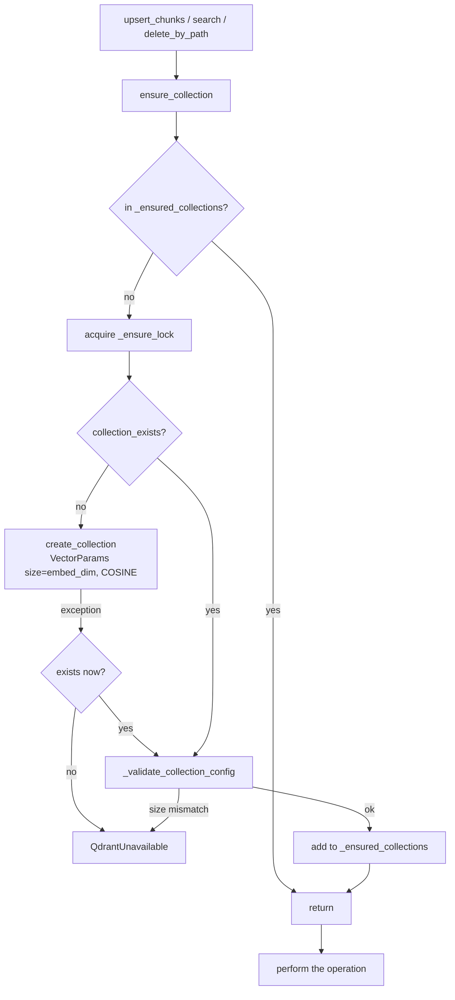

# Module: Qdrant Semantic Store

## Responsibilities

- Owns the **lifecycle of the per-workspace collection**: create it when missing, validate
  that an existing one is usable, cache the "ensured" state per `(url, collection)`.
- Owns the **point identity**: a stable UUID5 per `(path, chunk_index)` so re-indexing
  replaces points instead of duplicating them.
- Provides the three write/read operations: `upsert_chunks`, `delete_by_path`, `search`.
- Serializes the create race and reports health through `LAST_OK`.

## Key Files

| Path | Purpose |
|---|---|
| `src/simple_code_indexer/qdrant_store.py` | The whole module |
| `src/simple_code_indexer/indexer.py` | Calls upsert / delete on the write path |
| `src/simple_code_indexer/server.py` | Calls `search` on the semantic query path |
| `src/simple_code_indexer/config.py` | Derives the collection name |

## Public Interfaces

| Name | Kind | Description |
|---|---|---|
| `ensure_collection(settings)` | function | Create-if-missing + validate; idempotent |
| `upsert_chunks(settings, path, items)` | function | `list[tuple[Chunk, list[float]]]` → points |
| `delete_by_path(settings, path)` | function | Remove every point of a file |
| `search(settings, vector, limit) -> list[VectorHit]` | function | Nearest-chunk search |
| `point_id(path, chunk_index) -> uuid.UUID` | function | `uuid5(POINT_NAMESPACE, f"{path}:{chunk_index}")` |
| `POINT_NAMESPACE` | module constant | `uuid5(NAMESPACE_URL, "simple-code-indexer")` |
| `VectorHit` | NamedTuple | `path`, `chunk_index`, `score` |
| `LAST_OK` | module global | Read by `get_status.qdrant_ok` |

## Inputs and Outputs

| Type | Name | Location | Description |
| --- | --- | --- | --- |
| Input | Chunk + vector pairs | `indexer._embed_and_store` | What to store |
| Input | Query vector | `server._semantic_hits` | The embedded search phrase |
| Input | Settings | `config.Settings` | URL, collection name, vector dimension |
| Output | Qdrant points | collection `code_index_{slug}_{hash8}_{dim}` | payload `{path, chunk_index}` |
| Output | `VectorHit` list | `search` | path, chunk index, cosine score |
| Output | Health flag | `qdrant_store.LAST_OK` | Consumed by `get_status` |

## Configuration

| Setting | Env | Default | Notes |
|---|---|---|---|
| `qdrant_url` | `QDRANT_URL` | `http://localhost:6333` | No auth on this deployment |
| `qdrant_collection` | `QDRANT_COLLECTION` | derived per workspace | `code_index_{slug}_{sha256(path)[:8]}_{dim}` |
| `embed_dim` | `EMBED_DIM` | `2560` | The collection's vector size; validated on every ensure |

## Example Snippets

The collection guard — create once, validate always:

```python
def ensure_collection(settings: Settings) -> None:
    global LAST_OK
    from qdrant_client.models import Distance, VectorParams

    cache_key = (settings.qdrant_url, settings.qdrant_collection)
    if cache_key in _ensured_collections:
        return
    with _ensure_lock:
        if cache_key in _ensured_collections:
            return
        try:
            client = _client(settings)
            if not client.collection_exists(settings.qdrant_collection):
                try:
                    client.create_collection(
                        settings.qdrant_collection,
                        vectors_config=VectorParams(
                            size=settings.embed_dim, distance=Distance.COSINE
                        ),
                    )
                except Exception as exc:
                    if not client.collection_exists(settings.qdrant_collection):
                        raise
                    logger.debug("collection %s was created concurrently (%s)",
                                 settings.qdrant_collection, exc)
            _validate_collection_config(client, settings)
            _ensured_collections.add(cache_key)
            LAST_OK = True
        except QdrantUnavailable:
            LAST_OK = False
            raise
        except Exception as exc:
            LAST_OK = False
            raise QdrantUnavailable(f"cannot ensure collection: {exc}") from exc
```

The vector-size validation that turns a silent data loss into a loud error:

```python
def _validate_collection_config(client: Any, settings: Settings) -> None:
    vectors = client.get_collection(settings.qdrant_collection).config.params.vectors
    size = getattr(vectors, "size", None)
    if size is None:
        raise QdrantUnavailable(
            f"collection {settings.qdrant_collection} does not use a single "
            f"unnamed vector of size {settings.embed_dim}"
        )
    if int(size) != settings.embed_dim:
        raise QdrantUnavailable(
            f"collection {settings.qdrant_collection} has vector size {size}, "
            f"expected {settings.embed_dim}; delete it or align EMBED_DIM"
        )
```

Idempotent upsert with a stable ID:

```python
points = [
    PointStruct(
        id=str(point_id(path, chunk.chunk_index)),
        vector=vector,
        payload={"path": path, "chunk_index": chunk.chunk_index},
    )
    for chunk, vector in items
]
_client(settings).upsert(settings.qdrant_collection, points=points, wait=True)
```

## Edge Cases

- **First use is a three-way race** — the service-probe thread, the index writer and a
  semantic search all call `ensure_collection` at once. The in-process lock plus the
  re-check on a failed create makes the losers safe; an unguarded check-then-create
  answered `409 Conflict` and silently cost the workspace every vector.
- **Collection exists with a different vector size** → `QdrantUnavailable` with both numbers.
- **Collection uses named vectors** → `QdrantUnavailable` (the client cannot write to it).
- **Qdrant unreachable** → every operation raises `QdrantUnavailable`; indexing stays
  fail-soft and `qdrant_ok` is `False`.
- **Points whose chunk row vanished** → the point is skipped at query time; the lexical row
  is the source of truth.
- **Points left behind by a failed delete** → harmless orphans; delete by hand if needed.
- **Empty upsert list** → returns immediately without a round trip.
- **Missing payload keys** → the point is skipped rather than raising.

## Diagrams



## Tests

- `tests/test_qdrant_store.py` — point-ID stability, payload shape, the collection guard,
  and the error paths.
- `tests/test_multi_workspace_isolation.py` — two workspaces get two collections and never
  cross-hit.
- `tests/test_indexer.py` — stubs `qdrant_store.upsert_chunks` in unit tests.

## Source References

- `src/simple_code_indexer/qdrant_store.py`
- `src/simple_code_indexer/config.py`
- `src/simple_code_indexer/indexer.py`
- `src/simple_code_indexer/server.py`
- `src/simple_code_indexer/models.py`
- `src/simple_code_indexer/errors.py`
- `src/simple_code_indexer/setup_wizard/provision.py`
- `tests/test_qdrant_store.py`
- `tests/test_multi_workspace_isolation.py`
- `docs/adr/0008-host-spawned-cwd-per-repo-collections.md`
- `docs/tdd.md`
- `NOTES.md`