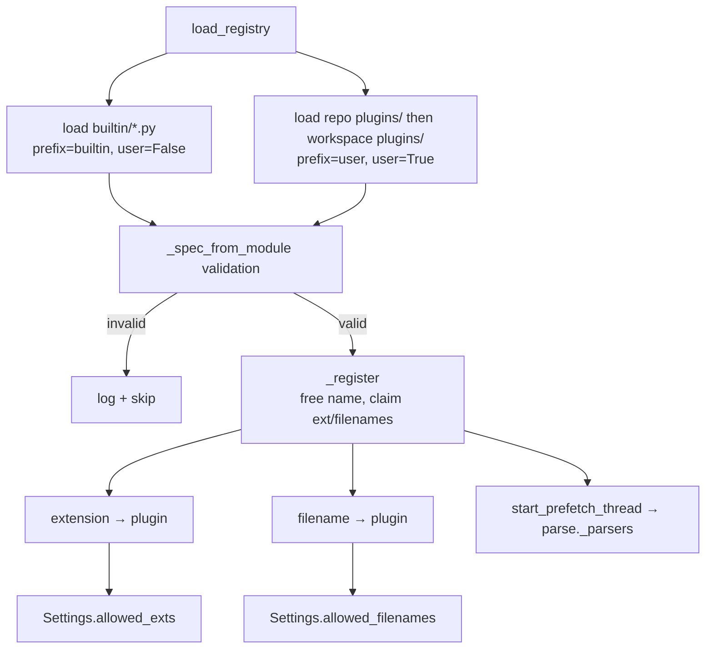

# Module: Language Plugin Registry

## Responsibilities

- Discover and load **language plugins** from three search locations, later ones winning:
  builtin package → `<repo>/plugins/` → `<workspace>/plugins/`.
- Turn plugin modules into validated `LanguageSpec` records and maintain the reverse indexes
  (extension → plugin, filename → plugin).
- Resolve **extension and filename collisions**: a user plugin overrides a builtin by `NAME`
  and steals the extensions and filenames it claims.
- Keep the loader **fail-soft**: a plugin that fails to import or validate is logged and
  skipped, never fatal.
- Provide the **allowlists** the indexer and watcher use to decide what to read.
- Warm the tree-sitter grammars in a **background thread** so startup stays fast.

## Key Files

| Path | Purpose |
|---|---|
| `src/simple_code_indexer/registry.py` | The loader, the registry and the collision rules |
| `src/simple_code_indexer/builtin/*.py` | 36 builtin language plugins |
| `src/simple_code_indexer/builtin/_c_family.py` | The shared C/C++ extractor |
| `plugins/README.md` | The user-plugin contract |

## Public Interfaces

| Name | Kind | Description |
|---|---|---|
| `get_registry() -> PluginRegistry` | function | The cached, lazily built registry |
| `reset_registry()` | function | Drops the cache (tests only) |
| `load_registry(*, user_dirs=None, include_builtin=True)` | function | Builds a fresh registry |
| `default_user_plugin_dirs() -> list[Path]` | function | Repo `plugins/` then workspace `plugins/` |
| `prefetch_grammars(registry=None)` | function | Best-effort load of every grammar |
| `start_prefetch_thread() -> Thread\|None` | function | Background prefetch; `None` when disabled |
| `PluginRegistry.detect(path) -> LanguageSpec\|None` | method | Path → spec (filename first, then extension) |
| `PluginRegistry.extension_allowlist()` | method | `frozenset` of extensions |
| `PluginRegistry.filename_allowlist()` | method | `frozenset` of exact filenames |
| `PluginRegistry.grammars()` | method | Distinct grammar names |
| `PluginRegistry.names()` | method | Sorted plugin names |
| `LanguageSpec` | frozen dataclass | name, grammar, extensions, filenames, symbol_nodes, extract |

### Plugin module contract

| Attribute | Required | Meaning |
|---|---|---|
| `NAME` | yes | Stable language id stored in `FileRecord.language` |
| `GRAMMAR` | yes | `tree_sitter_language_pack.get_parser` name |
| `EXTENSIONS` | one of | Dotted suffixes; **bare tokens are treated as filenames** |
| `FILENAMES` | one of | Exact basenames (`Dockerfile`, `CMakeLists.txt`) |
| `SYMBOL_NODES` | no | tree-sitter node type → symbol kind |
| `extract(root, source)` | no | Specialized extractor replacing the generic walker |

## Inputs and Outputs

| Type | Name | Location | Description |
| --- | --- | --- | --- |
| Input | Plugin modules | `builtin/`, `<repo>/plugins/`, `<workspace>/plugins/` | Plain `.py` files with module globals |
| Input | File path | `registry.detect(path)` | Which plugin owns it |
| Output | `LanguageSpec` | `registry.detect` | Grammar, allowlist entries, extractor |
| Output | Allowlists | `Settings.allowed_exts` / `allowed_filenames` | The indexer's read policy |
| Output | Grammar cache | `parse._parsers` | Warmed in the background |
| Output | Plugin count | `get_status.plugins_loaded` | `len(registry)` |

## Configuration

- `PREFETCH_GRAMMARS=0` — disables the background prefetch thread (`start_prefetch_thread`
  returns `None`).
- `WORKSPACE_ROOT` — decides where `<workspace>/plugins/` is looked up.

## Example Snippets

The collision rule — a user plugin wins and takes the extensions with it:

```python
def _register(self, spec: LanguageSpec, *, user: bool) -> None:
    self._free_name(spec.name)
    extensions: set[str] = set()
    for ext in spec.extensions:
        owner = self._by_ext.get(ext)
        wins = owner is None or user or _EXT_OWNERS.get(ext) == spec.name
        if wins:
            if owner is not None and owner != spec.name:
                self._release_ext_from(owner, ext)
            self._by_ext[ext] = spec.name
            extensions.add(ext)
        else:
            logger.debug("plugin %s loses %s to %s", spec.name, ext, owner)
    ...
```

The builtin-vs-builtin preference table:

```python
# Builtin-vs-builtin extension owners (v1 mapping + original preference).
_EXT_OWNERS: dict[str, str] = {".h": "cpp", ".m": "objc"}
```

The allowlist normalisation — bare tokens become filenames:

```python
for token in raw_exts:
    if not isinstance(token, str) or not token:
        logger.warning("plugin %s EXTENSIONS must be strings", path)
        return set(), set()
    if token.startswith("."):
        extensions.add(token.lower())
    else:
        filenames.add(token)
```

A builtin plugin in full:

```python
"""Builtin C++ plugin (specialized declarator-chain extractor)."""
NAME = "cpp"
GRAMMAR = "cpp"
EXTENSIONS = [".cpp", ".cc", ".cxx", ".c++", ".hpp", ".h", ".hh", ".h++", ".hxx"]
FILENAMES: list[str] = []

def extract(root: Any, source: str) -> list[Symbol]:
    return extract_c_family(root, source)
```

## Edge Cases

- **Plugin raises on import** → logged ("plugin … raised on import") and skipped.
- **Missing `NAME` or `GRAMMAR`** → skipped with a warning.
- **No `EXTENSIONS` and no `FILENAMES`** → skipped (the plugin would be inert).
- **`EXTENSIONS` is a string, not a list** → skipped.
- **`SYMBOL_NODES` is not `dict[str, str]`** → skipped.
- **`extract` is not callable** → skipped.
- **Files starting with `_`** are ignored (they are helpers, not plugins).
- **User plugin overrides a builtin by `NAME`** → the builtin is freed first, including its
  extension and filename ownership. **Redeclare the original extensions**, or `.cpp`/`.py`
  stop matching — this is a debug-log-only behaviour and easy to miss.
- **`detect_language` returns the plugin `NAME`**, not the pack grammar — e.g. `c_sharp`, not
  `csharp`.
- **Grammars not downloaded** → `get_parser` raises; `parse.extract_symbols` falls back to the
  regex scan.

## Diagrams



## Tests

- `tests/test_registry.py` — loading, validation, collisions, the allowlists and the prefetch.
- `tests/test_config.py` — the allowlist reaching `Settings`.
- `tests/test_parse.py` — detection and extraction through the registry.

## Source References

- `src/simple_code_indexer/registry.py`
- `src/simple_code_indexer/builtin/_c_family.py`
- `src/simple_code_indexer/builtin/cpp.py`
- `src/simple_code_indexer/builtin/python.py`
- `src/simple_code_indexer/builtin/dockerfile.py`
- `src/simple_code_indexer/parse.py`
- `src/simple_code_indexer/config.py`
- `plugins/README.md`
- `tests/test_registry.py`
- `docs/tdd.md`
- `NOTES.md`