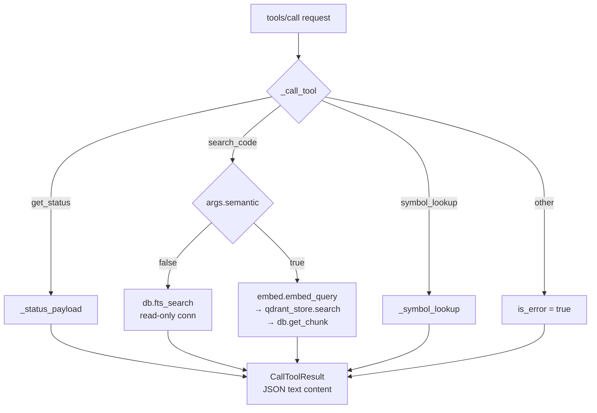

# Module: MCP Server

## Responsibilities

- Declares the **complete** MCP tool surface (exactly three tools) and dispatches
  `tools/call` to the right handler.
- Owns the **startup sequence**: workspace lock → managed services → schema + index identity →
  service probe → index writer → watcher → sweep timer → stdio serve.
- Builds the `get_status` payload — the only way an operator can observe what a live harness
  actually spawned (workspace, collection, config file, service state).
- Keeps the MCP channel clean: **stdout is the protocol, stderr is the log**.
- Enforces the harness-safe surface (no `outputSchema`, no `capabilities.tasks`, no
  `execution.taskSupport` — ADR-0006).

## Key Files

| Path | Purpose |
|---|---|
| `src/simple_code_indexer/server.py` | The whole server: tools, dispatch, startup, status |
| `src/simple_code_indexer/__init__.py` | `main()` — the console-script entry point |
| `src/simple_code_indexer/errors.py` | `EmbedError`, `QdrantUnavailable` caught at the tool boundary |

## Public Interfaces

| Name | Kind | Description |
|---|---|---|
| `main()` | function | `asyncio.run(_run())` after configuring stderr logging |
| `_TOOLS` | module constant | The three `types.Tool` declarations |
| `server._run()` | coroutine | The startup + serve sequence |
| `server._call_tool(settings, name, args)` | function | Dispatch; returns `is_error=True` for an unknown tool |
| `server._status_payload(settings)` | function | The `get_status` dictionary |
| `server._search_code(settings, args)` | function | Lexical + semantic search |
| `server._symbol_lookup(settings, args)` | function | Exact-then-prefix symbol resolution |

### Tool contracts

| Tool | Arguments | Result |
|---|---|---|
| `search_code` | `query` (string, required), `semantic` (bool, default `false`), `limit` (int, default `10`) | `{"hits": [...], "source": "lexical"\|"semantic"}` |
| `symbol_lookup` | `symbol` (string, required) | Flat match, or `{symbol, found, matches[]}` |
| `get_status` | none | Status dictionary |

### `get_status` keys

| Key | Type | Meaning |
|---|---|---|
| `files_indexed` / `symbols_indexed` / `chunks_indexed` | int | Row counts from `db.stats` |
| `watcher_alive` | bool | The observer thread is running |
| `last_sweep` | string\|null | UTC ISO timestamp of the last completed sweep |
| `qdrant_ok` / `embed_ok` | bool | `LAST_OK` flags from the two clients |
| `workspace` / `index_db` / `config_file` | string\|null | Resolved paths — the workspace-inference check |
| `collection` | string | The Qdrant collection actually in use |
| `plugins_loaded` / `grammars_ready` | int | Registry size and loaded parser count |
| `services` | dict | `embedding` / `qdrant` → `running`/`started`/`unavailable`/`not_managed` |

## Inputs and Outputs

| Type | Name | Location | Description |
| --- | --- | --- | --- |
| Input | MCP request | stdin (stdio JSON-RPC) | `initialize`, `tools/list`, `tools/call` |
| Input | Settings | `config.load_settings()` | Resolved workspace, endpoints, collection |
| Input | Index rows | `<workspace>/.simple-ci/index.db` | Read via a **read-only** WAL connection |
| Output | MCP response | stdout | JSON text content inside `types.TextContent` |
| Output | Log lines | stderr | `logging.basicConfig(stream=sys.stderr)` |
| Output | Status snapshot | `get_status` result | Counts, paths, service states |

## Configuration

- **Environment**: `WORKSPACE_ROOT`, `SIMPLE_CI_CONFIG`, `INDEX_DB`, `QDRANT_URL`,
  `QDRANT_COLLECTION`, `EMBED_BASE_URL`, `EMBED_MODEL`, `EMBED_DIM`, `EMBED_API_KEY`,
  `EMBED_TIMEOUT_S`, `SWEEP_SECONDS`, `DEBOUNCE_MS`, `PREFETCH_GRAMMARS`.
- **Harness timeout**: the default 5000 ms tool budget is too small when managed containers
  block startup — the wizard writes `timeout: 120000`.

## Example Snippets

The complete startup order (the sequence matters — the lock is taken before anything else):

```python
async def _run() -> None:
    settings = load_settings()
    lock = _acquire_workspace_lock(settings.index_db_path)
    services.ensure_managed_services(settings)
    start_prefetch_thread()
    with db.connect(settings.index_db_path) as conn:
        db.ensure_schema(conn)
        with conn:
            if db.ensure_index_identity(
                conn,
                qdrant_url=settings.qdrant_url,
                collection=settings.qdrant_collection,
            ):
                logger.warning(
                    "collection changed to %s — index cleared for a full re-index",
                    settings.qdrant_collection,
                )
    threading.Thread(target=_probe_services, args=(settings,), name="service-probe", daemon=True).start()
    work_queue = indexer.new_work_queue()
    threading.Thread(target=indexer.writer_loop, args=(settings, work_queue),
                     name="index-writer", daemon=True).start()
    work_queue.put(indexer.SWEEP_REQUEST)
    watcher.start_watcher(settings, work_queue)
    threading.Thread(target=_periodic_sweep, args=(settings, work_queue),
                     name="sweep-timer", daemon=True).start()
    server = _build_server(settings)
    async with stdio_server() as (read_stream, write_stream):
        await server.run(read_stream, write_stream, server.create_initialization_options())
    lock.release()
```

Argument clamping and empty-query handling:

```python
query = str(args.get("query", ""))
try:
    limit = int(args.get("limit", 10))
except (TypeError, ValueError):
    limit = 10
limit = max(1, min(limit, 50))
semantic = bool(args.get("semantic", False))
if not query.strip():
    return {"hits": [], "source": "semantic" if semantic else "lexical"}
```

## Edge Cases

- **Unknown tool** → `CallToolResult(is_error=True, content=[TextContent("unknown tool")])`.
- **Non-integer `limit`** → falls back to 10 instead of raising; the value is clamped to 1..50.
- **Blank query** → an empty hit list, never a query against FTS5.
- **`args` missing entirely** → `params.arguments or {}` supplies an empty dict.
- **Semantic search failure** → caught as `EmbedError` / `QdrantUnavailable`, logged, and an
  empty hit list with `source: "semantic"` is returned — the tool never errors out.
- **Orphan vector points** → skipped at hit-mapping time; the lexical row is the source of truth.
- **Second server for the same workspace** → `SystemExit(1)` before anything is started.
- **Empty `symbols`** → `{"symbol": name, "found": False, "matches": []}`.
- **Ambiguous symbol** → `found: true` plus `matches[]` sorted by path.

## Diagrams



## Tests

- `tests/test_smoke.py` — the package imports and `main` is wired.
- `tests/mcp_probe.py` — a live stdio probe asserting the tool list, argument shapes and
  status keys (run manually, not by pytest).
- `tests/service_probe.py` — verifies the two backing services before the MCP probe.

## Source References

- `src/simple_code_indexer/server.py`
- `src/simple_code_indexer/__init__.py`
- `src/simple_code_indexer/indexer.py`
- `src/simple_code_indexer/watcher.py`
- `src/simple_code_indexer/services.py`
- `src/simple_code_indexer/workspace_lock.py`
- `src/simple_code_indexer/db.py`
- `src/simple_code_indexer/embed.py`
- `src/simple_code_indexer/qdrant_store.py`
- `src/simple_code_indexer/config.py`
- `src/simple_code_indexer/errors.py`
- `src/simple_code_indexer/registry.py`
- `docs/adr/0006-harness-safe-mcp-surface.md`
- `docs/tdd.md`