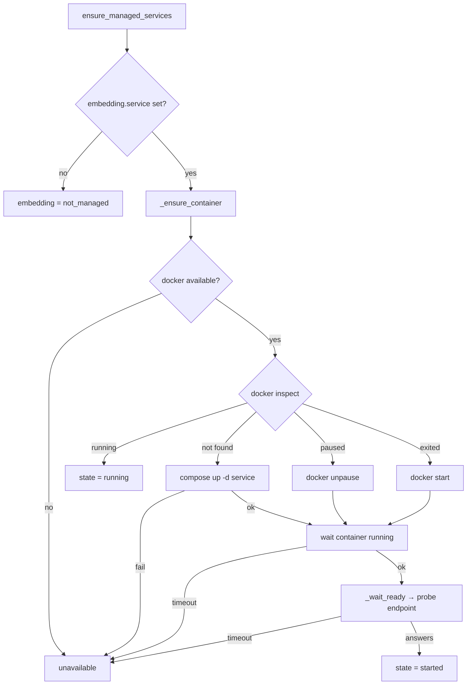

# Module: Managed Services

## Responsibilities

- Start and await the **Docker containers** the config names (`embedding.service` /
  `qdrant.service`) before the MCP server serves.
- Record the outcome of each managed service in `LAST_STATE`, which `get_status.services`
  exposes.
- **Never raise**: an unreachable service degrades the server to lexical-only search instead
  of blocking the session.
- Launch the Docker Desktop daemon when it is installed but not running.

## Key Files

| Path | Purpose |
|---|---|
| `src/simple_code_indexer/services.py` | The whole module: ensure, start, wait, probe |
| `src/simple_code_indexer/config.py` | `ManagedService` and the `service` block parsing |
| `src/simple_code_indexer/server.py` | Calls `ensure_managed_services` during startup |
| `src/simple_code_indexer/setup_wizard/provision.py` | Writes the compose file the `service` block points at |

## Public Interfaces

| Name | Kind | Description |
|---|---|---|
| `ensure_managed_services(settings)` | function | Ensure both services; never raises |
| `LAST_STATE` | module dict | `{"embedding": ..., "qdrant": ...}` |
| `_ensure_container(service) -> str\|None` | function | `"running"`, `"started"`, or `None` |
| `_wait_ready(kind, settings, timeout_s) -> bool` | function | Polls the endpoint until it answers |
| `_probe(kind, settings) -> bool` | function | One readiness request |
| `_docker_available() -> bool` | function | `docker info` with a daemon-start attempt |

### Service states

| State | Meaning |
|---|---|
| `not_managed` | No `service` block for this kind |
| `running` | The container was already running |
| `started` | The server started the container |
| `unavailable` | Docker missing, the container missing, or the endpoint never answered |

## Inputs and Outputs

| Type | Name | Location | Description |
| --- | --- | --- | --- |
| Input | `ManagedService` | `Settings.embedding_service` / `qdrant_service` | Container, compose file, compose service, timeout |
| Input | Docker CLI | `docker` on `PATH` | `inspect`, `start`, `unpause`, `compose up` |
| Input | Compose file | `service.compose_file` | Written by the wizard under `~/.simple-ci/` |
| Output | Container state | `services.LAST_STATE` | Read by `get_status.services` |
| Output | Running container | Docker daemon | Started and awaited before serving |

## Configuration

| YAML key | Meaning |
|---|---|
| `embedding.service.container` | Container name to inspect/start |
| `embedding.service.compose_file` | Compose file used when the container does not exist |
| `embedding.service.compose_service` | Compose service name |
| `embedding.service.startup_timeout_s` | How long to wait for the endpoint (default 45, wizard uses 60) |
| `qdrant.service.*` | The same four keys for Qdrant (wizard timeout 45) |

## Example Snippets

The ensure loop — every failure becomes a state, never an exception:

```python
def ensure_managed_services(settings: Settings) -> None:
    services = (("embedding", settings.embedding_service), ("qdrant", settings.qdrant_service))
    for kind, service in services:
        if service is None:
            LAST_STATE[kind] = "not_managed"
            continue
        try:
            state = _ensure_container(service)
            if state is None:
                LAST_STATE[kind] = "unavailable"
                continue
            if _wait_ready(kind, settings, service.startup_timeout_s):
                LAST_STATE[kind] = state
            else:
                logger.error("managed %s service %s did not become ready",
                             kind, service.container)
                LAST_STATE[kind] = "unavailable"
        except Exception:
            logger.exception("managed %s service failed", kind)
            LAST_STATE[kind] = "unavailable"
```

Container lifecycle — inspect, unpause or start, then wait:

```python
def _ensure_container(service: ManagedService) -> str | None:
    if not _docker_available():
        return None
    ok, status = _docker_output("inspect", "-f", "{{.State.Status}}", service.container)
    if not ok:
        logger.warning("container %s not found; trying its compose service", service.container)
        if not _compose_up(service):
            return None
        return "started" if _wait_container(service.container) else None
    if status == "running":
        return "running"
    if status == "paused":
        started = _docker("unpause", service.container)
    else:
        started = _docker("start", service.container)
    if not started:
        return None
    if not _wait_container(service.container):
        return None
    return "started"
```

The readiness probes — one HTTP call per kind:

```python
def _probe(kind: str, settings: Settings) -> bool:
    if kind == "qdrant":
        base = settings.qdrant_url.rstrip("/")
        return _http_get(base + "/healthz", _PROBE_TIMEOUT_S) or _http_get(
            base + "/collections", _PROBE_TIMEOUT_S
        )
    headers = _embed_headers(settings)
    return _http_post(
        settings.embed_base_url.rstrip("/") + "/v1/embeddings",
        {"model": settings.embed_model, "input": ["ping"]},
        headers,
        _PROBE_TIMEOUT_S,
    )
```

## Edge Cases

- **Docker not installed** → `_docker_available()` returns `False`; the state becomes
  `unavailable`; the server still serves lexical search.
- **Docker installed but the daemon is down** → the module tries to launch Docker Desktop
  (`win32`), `open -a Docker` (`darwin`) or `systemctl --user start docker` (Linux), then
  waits up to 30 s.
- **Container does not exist** → `docker compose -f <file> up -d <service>` is attempted; if
  there is no compose file the state is `unavailable`.
- **Container paused** → `docker unpause` instead of `start`.
- **Endpoint never answers** → the wait loop times out; the state is `unavailable` and a
  `did not become ready` error is logged.
- **HTTP error status** → a status below 500 counts as "up" (`status_code < 500`).
- **Compose file missing** → logged as an error; no container is started.
- **Docker command times out** → 10 s for `docker` calls, 180 s for `compose up`.
- **Test seams** — `_run`, `_popen`, `_which`, `_clock`, `_sleep` are module-level so the unit
  tests never shell out or touch the network.

## Diagrams



## Tests

- `tests/test_services.py` — container states, the probe behaviour, the Docker-daemon path and
  the fail-soft contract (all with injected seams).
- `tests/test_config.py` — the `service` block parsing and its validation errors.
- `tests/test_setup_wizard.py` — the wizard side of provisioning.

## Source References

- `src/simple_code_indexer/services.py`
- `src/simple_code_indexer/config.py`
- `src/simple_code_indexer/server.py`
- `src/simple_code_indexer/setup_wizard/provision.py`
- `src/simple_code_indexer/setup_wizard/__init__.py`
- `tests/test_services.py`
- `tests/test_config.py`
- `docs/adr/0009-setup-wizard-managed-services-config.md`
- `docs/tdd.md`
- `NOTES.md`