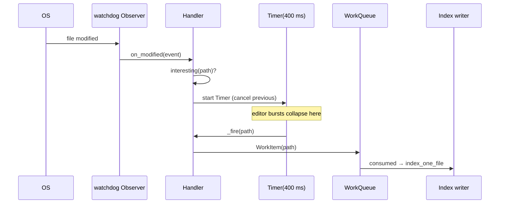
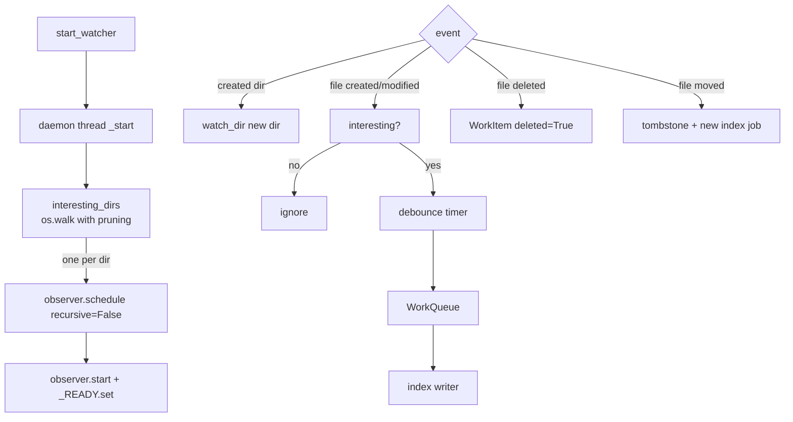

# Module: Watcher

## Responsibilities

- Turn native filesystem events into **debounced index work items** — never index inside the
  observer callback.
- Register **one non-recursive watch per interesting directory** instead of one recursive
  watch over the workspace root.
- Pick up **newly created directories** from directory-created events.
- Filter out files that the indexer would reject anyway (allowlist, temp names, ignored
  directories).
- Report liveness through `watcher.is_alive()`, read by `get_status.watcher_alive`.

## Key Files

| Path | Purpose |
|---|---|
| `src/simple_code_indexer/watcher.py` | The whole module: handler, debounce, registration |
| `src/simple_code_indexer/indexer.py` | Consumes the `WorkItem`s the watcher produces |
| `src/simple_code_indexer/config.py` | `is_allowed`, `is_temp_name`, `ignore_dirs`, `debounce_ms` |

## Public Interfaces

| Name | Kind | Description |
|---|---|---|
| `start_watcher(settings, work_queue) -> BaseObserver` | function | Registers the watches on a daemon thread |
| `build_handler(settings, work_queue, watch_dir)` | function | The event handler factory |
| `interesting_dirs(settings) -> list[str]` | function | The directories that get a watch |
| `wait_until_ready(timeout) -> bool` | function | Blocks until the observer started (tests/diagnostics) |
| `is_alive() -> bool` | function | Observer liveness |
| `_OBSERVER` / `_READY` | module globals | The observer and its ready event |

## Inputs and Outputs

| Type | Name | Location | Description |
| --- | --- | --- | --- |
| Input | Filesystem events | watchdog Observer | create / modify / move / delete |
| Input | Workspace tree | `interesting_dirs` | The directories to watch (ignored ones pruned) |
| Input | Settings | `config.Settings` | `debounce_ms`, allowlist, ignore dirs |
| Output | `WorkItem(path)` | work queue | An index request for a changed file |
| Output | `WorkItem(path, deleted=True)` | work queue | A tombstone for a removed file |
| Output | New watch | `watch_dir` | Registered for a newly created directory |
| Output | Liveness flag | `watcher.is_alive()` | Consumed by `get_status` |

## Configuration

- `Settings.debounce_ms` (default **400**) — the per-path timer window.
- `Settings.ignore_dirs` — `.git`, `.index`, `.simple-ci`, `__pycache__`, `.venv`,
  `node_modules`.
- `Settings.allowed_exts` / `allowed_filenames` — the allowlist.
- Editor temp names — `*~`, `*.tmp`, `*.swp`, `*.swx`, `*.part`, `.#*`.

## Example Snippets

The debounce — one timer per path, previous timer cancelled:

```python
def _schedule_index(self, path: str) -> None:
    if not interesting(path):
        return
    previous = self._timers.pop(path, None)
    if previous is not None:
        previous.cancel()
    timer = threading.Timer(debounce_s, self._fire, args=(path,))
    timer.daemon = True
    self._timers[path] = timer
    timer.start()
```

The event handling — create / modify / move / delete:

```python
def on_created(self, event):
    if event.is_directory:
        watch_dir(str(event.src_path))
    else:
        self._schedule_index(str(event.src_path))

def on_modified(self, event):
    if not event.is_directory:
        self._schedule_index(str(event.src_path))

def on_moved(self, event):
    if event.is_directory:
        watch_dir(str(event.dest_path))
        return
    if interesting(str(event.src_path)):
        enqueue(WorkItem(Path(str(event.src_path)), deleted=True))
    self._schedule_index(str(event.dest_path))

def on_deleted(self, event):
    if not event.is_directory and interesting(str(event.src_path)):
        enqueue(WorkItem(Path(str(event.src_path)), deleted=True))
```

The pruned directory list — the reason recursion is avoided:

```python
def interesting_dirs(settings: Settings) -> list[str]:
    """Workspace dirs that may hold indexed files (ignored dirs pruned)."""
    dirs: list[str] = []
    for dirpath, dirnames, _filenames in os.walk(settings.workspace_root, topdown=True):
        dirnames[:] = [d for d in dirnames if d not in settings.ignore_dirs]
        dirs.append(dirpath)
    return dirs
```

## Edge Cases

- **Recursive scheduling** → registration over `.venv` blocked for >10 s and `watcher_alive`
  never went true. One non-recursive watch per directory is the fix.
- **Queue full** → the item is dropped with a warning; the reconciliation sweep covers it.
- **Rapid save bursts** (editor temp file + rename) → collapsed into one job by the debounce.
- **Directory created after startup** → picked up from the directory-created event.
- **Directory deleted** → the watch registration dies with it; the sweep removes stale rows.
- **File renamed** → a tombstone for the old path plus an index job for the new path.
- **Non-indexable file events** → filtered by `interesting()` before any timer is created.
- **Watcher start failure** → logged; the server still serves (the sweep remains the backstop).
- **Timers touched from two threads** → the worst case is one extra idempotent index.

## Diagrams





## Tests

- `tests/test_watcher.py` — the handler's filtering and debounce behaviour.
- `tests/live_watch_probe.py` — the end-to-end index-on-save latency measurement.
- `tests/test_indexer.py` — the consumer side of the queue contract.

## Source References

- `src/simple_code_indexer/watcher.py`
- `src/simple_code_indexer/indexer.py`
- `src/simple_code_indexer/config.py`
- `src/simple_code_indexer/server.py`
- `src/simple_code_indexer/errors.py`
- `tests/test_watcher.py`
- `tests/live_watch_probe.py`
- `docs/adr/0008-host-spawned-cwd-per-repo-collections.md`
- `docs/tdd.md`
- `NOTES.md`