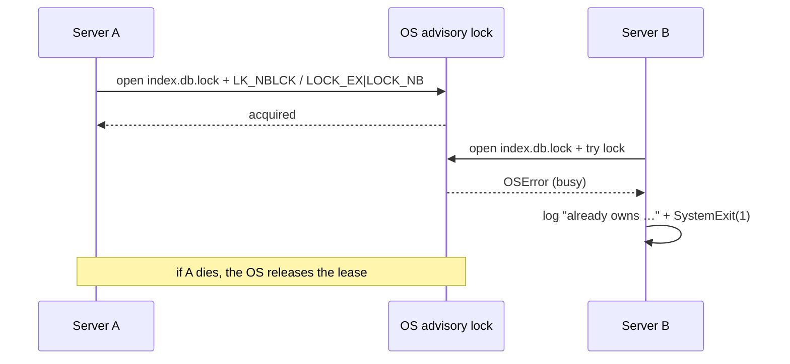

# Module: Workspace Lock

## Responsibilities

- Enforce the **single-writer invariant** (ADR-0004) at the *process* level: only one
  `simple-code-indexer` may own a workspace's index at a time.
- Use an **OS advisory lease** rather than a lock file with a PID, so a killed session never
  leaves a stale lock behind.
- Stay platform-correct: `msvcrt.locking` on Windows, `fcntl.flock` elsewhere.

## Key Files

| Path | Purpose |
|---|---|
| `src/simple_code_indexer/workspace_lock.py` | The whole module |
| `src/simple_code_indexer/server.py` | Acquires the lock at startup, releases it on exit |
| `src/simple_code_indexer/setup_wizard/__init__.py` | Uses the same lock to guard the legacy index migration |

## Public Interfaces

| Name | Kind | Description |
|---|---|---|
| `WorkspaceLock(index_db_path)` | class | Constructs the lock path `<index.db>.lock` |
| `acquire() -> bool` | method | Takes the lease; `False` when another live process owns it |
| `release()` | method | Releases and closes the handle |

## Inputs and Outputs

| Type | Name | Location | Description |
| --- | --- | --- | --- |
| Input | Index DB path | `Settings.index_db_path` | The lock file is derived from it |
| Input | Process liveness | OS | The lease dies with the process |
| Output | Lock file | `<index_db>.lock` | May outlive the process — that is harmless |
| Output | Acquire result | `acquire()` | `True` = this process owns the workspace |

## Configuration

There is none — the lock is unconditional. The behaviour is fixed by ADR-0004 and enforced in
`server._acquire_workspace_lock`.

## Example Snippets

The lock acquisition, and what happens when it fails:

```python
def _acquire_workspace_lock(index_db_path: Path) -> workspace_lock.WorkspaceLock:
    """Enforce one writer per workspace; the lease dies with the process."""
    lock = workspace_lock.WorkspaceLock(index_db_path)
    if not lock.acquire():
        logger.error(
            "another simple-code-indexer already owns %s; refusing to start",
            index_db_path,
        )
        raise SystemExit(1)
    return lock
```

The lease itself — the open handle *is* the lock:

```python
class WorkspaceLock:
    """Non-blocking exclusive lease on `<index_db>.lock`.

    The open handle *is* the lease: the OS releases it when the process exits,
    so a killed session never leaves a stale lock behind (only the file stays).
    """

    def __init__(self, index_db_path: Path) -> None:
        self._path = index_db_path.with_name(index_db_path.name + ".lock")
        self._handle: BinaryIO | None = None

    def acquire(self) -> bool:
        if self._handle is not None:
            return True
        self._path.parent.mkdir(parents=True, exist_ok=True)
        handle = self._path.open("a+b")
        try:
            _lock(handle)
        except OSError:
            handle.close()
            return False
        self._handle = handle
        return True
```

The platform split:

```python
if sys.platform == "win32":
    import msvcrt

    def _lock(handle: BinaryIO) -> None:
        handle.seek(0)
        msvcrt.locking(handle.fileno(), msvcrt.LK_NBLCK, 1)

    def _unlock(handle: BinaryIO) -> None:
        handle.seek(0)
        msvcrt.locking(handle.fileno(), msvcrt.LK_UNLCK, 1)
else:
    import fcntl

    def _lock(handle: BinaryIO) -> None:
        fcntl.flock(handle.fileno(), fcntl.LOCK_EX | fcntl.LOCK_NB)

    def _unlock(handle: BinaryIO) -> None:
        fcntl.flock(handle.fileno(), fcntl.LOCK_UN)
```

## Edge Cases

- **A second server for the same workspace** → `acquire()` returns `False`; the server logs
  `another simple-code-indexer already owns …` and exits with status 1.
- **The process is killed** → the OS releases the lease; the `.lock` file stays on disk but
  carries no lock.
- **The parent directory does not exist** → it is created before the lock file is opened.
- **The lock file already exists** → it is opened in `"a+b"` mode, so it is reused, not
  truncated.
- **Re-entrant `acquire()`** → returns `True` without re-locking.
- **The index directory is read-only** → `open()` raises `OSError`; the server fails to start
  (a genuine misconfiguration).
- **`release()` without a successful acquire** → a no-op.
- **Wizard migration** → the wizard takes the same lock on the *legacy* `.index/index.db`
  before moving it, so a running server cannot be moved out from under.

## Diagrams



## Tests

- `tests/test_workspace_lock.py` — acquisition, contention and release semantics.
- `tests/test_multi_workspace_isolation.py` — two workspaces each get their own lock.
- `tests/test_setup_wizard.py` — the wizard's use of the lock during the legacy migration.

## Source References

- `src/simple_code_indexer/workspace_lock.py`
- `src/simple_code_indexer/server.py`
- `src/simple_code_indexer/setup_wizard/__init__.py`
- `src/simple_code_indexer/config.py`
- `tests/test_workspace_lock.py`
- `tests/test_multi_workspace_isolation.py`
- `docs/adr/0004-single-writer-sqlite-wal.md`
- `docs/tdd.md`
- `NOTES.md`