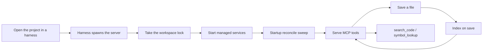

# Operations

The runbook: install, run, verify, rebuild, and recover.

## Install

```bash
git clone <repo> simple-code-indexer
cd simple-code-indexer
python setup.py
```

`setup.py` is a **launcher, not a setuptools script** — the package is built by `uv_build`,
which ignores the file. It:

1. Finds `uv` (or installs it: PowerShell on Windows, `curl | sh` elsewhere).
2. Runs `uv sync --project <repo>`.
3. Launches `python -m simple_code_indexer.setup_wizard` **with the caller's working
   directory preserved** — the wizard configures the project you are in, not the repo.

| Flag | Effect |
|---|---|
| `--dry-run` | Print every action; write nothing, start nothing |
| `--yes` | Accept the recommended default at every prompt |
| `--scope global\|local` | Force where `config.yaml` is written |
| `--config PATH` | Write the config to an explicit path |
| `--model-url URL` | Override the download URL of the first catalog model |

## Start and Stop

There is **nothing to stop**: the server is spawned by the harness and exits with the
session. The backing services are long-lived and are either yours or managed by the config.

```bash
# Qdrant, if you do not already run one
docker run -d --name qdrant -p 6333:6333 -v qdrant_storage:/qdrant/storage qdrant/qdrant
```

| Service | Endpoint |
|---|---|
| Embeddings (llama.cpp / OpenAI-compatible) | `http://localhost:8080/v1/embeddings` |
| Qdrant | `http://localhost:6333` |

### Harness integration

The wizard writes the entry for you. The equivalent global MiMoCode snippet:

```json
{
  "mcp": {
    "code-index": {
      "type": "local",
      "command": ["uvx", "--from", "d:/Projects/Python/simple-code-indexer", "simple-code-indexer"],
      "enabled": true,
      "timeout": 120000,
      "sampling": "deny"
    }
  }
}
```

- **Restart the harness session after changing the file** — the config is read at session start.
- The first `uvx` launch builds and installs into a cached environment (~5 s); every later
  launch is ~0.3 s. `uv tool install --from <repo> simple-code-indexer` once, then the bare
  command, removes even that.
- Gate: `mimo mcp list` must show `✓ code-index connected`.
- Tools exposed: `search_code` (lexical; `semantic=true` for Qdrant), `symbol_lookup`,
  `get_status`.

## Verify

```bash
uv run python tests/service_probe.py     # expect: embeddings OK dim=<your config>, qdrant OK, PROBE OK
uv run python tests/mcp_probe.py         # stdio protocol + tool shapes
uv run python tests/live_watch_probe.py  # index-on-save latency
```

Run them from the workspace you want indexed: each probe spawns the server, which inherits
that cwd unless `WORKSPACE_ROOT` is set.

| Probe | What it proves |
|---|---|
| `service_probe.py` | The embedding endpoint answers with the expected dimension and Qdrant is reachable |
| `mcp_probe.py` | `initialize` → `tools/list` → `tools/call` work; the tool shapes and status keys are intact |
| `live_watch_probe.py` | A save is picked up and searchable within seconds (it creates and removes its own temp `.cpp`) |

`get_status` reports the resolved `workspace`, `collection`, `config_file` and `services`
(`running`, `started`, `unavailable`, `not_managed`).

## The Acceptance Path

1. `uv run python tests/service_probe.py` — Qdrant and embeddings are reachable.
2. `mimo mcp list` → `✓ connected`.
3. Restart the harness session (config is read at session start).
4. Create `widget_checksum.cpp` with the unique symbol `calculateWidgetChecksum`.
5. Poll `search_code` / `symbol_lookup` until it is found (target < 5 s).
6. `search_code(..., semantic=true)` returns a hit (vectors may lag a few seconds).
7. `get_status` is healthy, with the expected `workspace` and `collection`.
8. Open a second project in another session → a different `collection`, and no cross-hits.

## Rebuild the Index

The lexical index lives at `$WORKSPACE_ROOT/.simple-ci/index.db`; the vectors live in the
per-workspace Qdrant collection. Switching collection — moving the project, changing
`EMBED_DIM`, editing `QDRANT_COLLECTION`, or changing the embedding model — invalidates the
stored rows automatically on the next start, and the startup reconcile re-indexes and
re-embeds everything.

To force it by hand (for example after upgrading code that changes chunking):

```bash
Remove-Item -Recurse -Force .simple-ci   # or: rm -rf .simple-ci
# then trigger any MCP call: startup reconcile re-embeds everything
```

Deleting only `index.db` is enough; deleting the whole directory also drops a local
`config.yaml`.

## Health Checks

| Check | Where | Healthy value |
|---|---|---|
| Index counts | `get_status.files_indexed` / `symbols_indexed` / `chunks_indexed` | Non-zero for a real project |
| Watcher | `get_status.watcher_alive` | `true` within ~1 s of the first call |
| Sweep age | `get_status.last_sweep` | A recent UTC ISO timestamp |
| Qdrant | `get_status.qdrant_ok` | `true` |
| Embeddings | `get_status.embed_ok` | `true` |
| Workspace | `get_status.workspace` | The project you opened |
| Collection | `get_status.collection` | `code_index_{slug}_{hash8}_{dim}` |
| Plugins | `get_status.plugins_loaded` / `grammars_ready` | 36 / growing towards 36 |
| Services | `get_status.services` | `running` or `started` |

## Daily Workflow


## Retired State

The pre-ADR-0008 deployment used a global collection `code_index_2560` and a `docker
exec`-attached container. Nothing reads that collection now — delete it in Qdrant by hand
when convenient. The old `.index/` directory is migrated by the wizard and remains ignored
for backwards compatibility.

## Diagrams



The lifecycle of one harness session, from spawning the server to the first
indexed save.
## Source References

- `setup.py`
- `README.md`
- `src/simple_code_indexer/setup_wizard/__init__.py`
- `src/simple_code_indexer/setup_wizard/provision.py`
- `src/simple_code_indexer/setup_wizard/write.py`
- `src/simple_code_indexer/services.py`
- `src/simple_code_indexer/server.py`
- `src/simple_code_indexer/db.py`
- `tests/service_probe.py`
- `tests/mcp_probe.py`
- `tests/live_watch_probe.py`
- `docs/tdd.md`
- `docs/adr/0008-host-spawned-cwd-per-repo-collections.md`