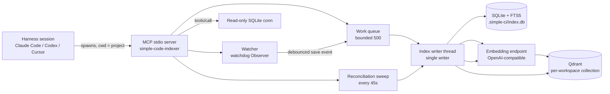

# Overview

## Purpose

`simple-code-indexer` is a **local code-index MCP server**. It watches one workspace
directory, extracts symbols and text chunks from source files on save, and exposes three
MCP tools so an AI coding assistant can find code without reading whole files.

- **Lexical search** — SQLite + FTS5 (BM25) over chunk text.
- **Semantic search** — Qdrant vectors over the same chunks.
- **Symbol lookup** — resolve a symbol name to its definition site (file, lines, kind, signature).

Primary consumers are MCP hosts ("harnesses"): Claude Code, Codex CLI, Gemini CLI, Cursor,
VS Code, Zed, OpenCode, Windsurf, Cline, Command Code and MiMoCode. The server is spawned
**by the harness on the host**, with the harness session's project as the process working
directory, and exits with the session.

Non-goals are explicit and documented: git readiness / commit gating, multi-repo registry,
LLM chunk summaries before vectors, staged generation rebuilds, and any MCP feature the
harness rejects (`outputSchema`, `capabilities.tasks`, `execution.taskSupport`).

## Repo Layout

| Path | Role |
|---|---|
| `src/simple_code_indexer/` | The package — MCP server, indexer, stores, config, plugins, wizard |
| `src/simple_code_indexer/builtin/` | 36 builtin language plugins (tree-sitter grammar + allowlist) |
| `src/simple_code_indexer/harnesses/` | 13 builtin MCP-client plugins + JSON/TOML merge helpers |
| `src/simple_code_indexer/setup_wizard/` | Interactive setup: prompts, probes, Docker provisioning, config writes |
| `setup.py` | Repo-root launcher: installs `uv`, syncs, hands over to the wizard (not setuptools) |
| `tests/` | pytest suite (16 test modules, ~126 tests) + three standalone probes |
| `docs/adr/` | 9 architecture decision records (the why behind the shape) |
| `docs/tdd.md` | Technical design — the build contract |
| `plugins/`, `harnesses/` | Tracked user drop-in folders (overrides by `NAME`) |
| `artifacts/` | Throwaway handoff / planning scratch files |
| `deepwiki/` | This generated documentation set |

## Entry Points

| Entry point | Invocation | Purpose |
|---|---|---|
| `simple-code-indexer` | `uvx --from <repo> simple-code-indexer` | MCP stdio server; the harness spawns this |
| `simple_code_indexer.main` | `python -m simple_code_indexer` | Same server, via the package `__init__` |
| `setup.py` | `python setup.py [--dry-run] [--yes] [--scope global\|local]` | Interactive setup wizard |
| `setup_wizard.__main__` | `python -m simple_code_indexer.setup_wizard` | Wizard entry, used by `setup.py` |
| `tests/service_probe.py` | `uv run python tests/service_probe.py` | Probe embeddings + Qdrant |
| `tests/mcp_probe.py` | `uv run python tests/mcp_probe.py` | Probe the stdio MCP contract and tool shapes |
| `tests/live_watch_probe.py` | `uv run python tests/live_watch_probe.py` | Measure index-on-save latency |

The server binary is declared in `pyproject.toml` as
`simple-code-indexer = "simple_code_indexer:main"`.

## Key Artifacts

- **`<workspace>/.simple-ci/index.db`** — SQLite (WAL) lexical index plus the FTS5 mirror.
  Gitignore the whole `.simple-ci/` directory.
- **`<workspace>/.simple-ci/index.db.lock`** — OS advisory lock file; the *open handle* is the
  lease, so the file surviving a crash is harmless.
- **`<workspace>/.simple-ci/config.yaml`** — optional per-project config (may hold an API key).
- **`~/.simple-ci/config.yaml`** — global config, used when the project has no local file.
- **`~/.simple-ci/docker-compose.yml`** — compose file the wizard generates for `embed` and `qdrant`.
- **`~/.simple-ci/models/*.gguf`** — downloaded embedding models.
- **`code_index_{slug}_{sha256(path)[:8]}_{embed_dim}`** — the per-workspace Qdrant collection.

## Key Workflows

1. **First-time setup** — `python setup.py` → wizard probes an embedding endpoint, provisions
   Qdrant, probes the vector dimension, writes `config.yaml`, registers the server with every
   detected harness. `--dry-run` prints every action without touching files or containers.
2. **Session start** — the harness spawns `uvx --from <repo> simple-code-indexer` in the project
   directory. The server takes its workspace from the cwd, starts managed containers, takes the
   workspace lock, starts the writer + watcher, and serves MCP over stdio.
3. **Index on save** — a native filesystem event → per-path debounce (400 ms) → bounded work
   queue → single writer thread → parse → SQLite upsert → embed → Qdrant upsert.
4. **Query** — `search_code` (lexical or `semantic=true`), `symbol_lookup`, `get_status`.
5. **Reconciliation** — every `SWEEP_SECONDS` (45 s) the writer walks the tree, re-indexes
   drift, deletes vanished paths, and retries chunks whose embedding failed.

## Example Snippets

MCP tool surface (exactly three tools — no `outputSchema`, per ADR-0006):

```python
_TOOLS = [
    types.Tool(
        name="search_code",
        description="Search the index; semantic=true for vector hits.",
        input_schema={
            "type": "object",
            "properties": {
                "query": {"type": "string"},
                "semantic": {"type": "boolean", "default": False},
                "limit": {"type": "integer", "default": 10},
            },
            "required": ["query"],
        },
    ),
    types.Tool(name="symbol_lookup", ...),
    types.Tool(name="get_status", ...),
]
```

A `get_status` response (shape is the contract; it is probe-tested, not schema-enforced):

```json
{
  "files_indexed": 12,
  "symbols_indexed": 87,
  "chunks_indexed": 240,
  "watcher_alive": true,
  "last_sweep": "2026-10-17T20:01:02Z",
  "qdrant_ok": true,
  "embed_ok": true,
  "workspace": "d:/projects/my-app",
  "collection": "code_index_my-app_a1b2c3d4_2560",
  "index_db": "d:/projects/my-app/.simple-ci/index.db",
  "config_file": "C:/Users/me/.simple-ci/config.yaml",
  "services": {"embedding": "running", "qdrant": "started"}
}
```

## Where to Start

- **To understand the runtime**: `src/simple_code_indexer/server.py` — it wires the lock,
  managed services, schema, identity check, writer, watcher and the stdio loop in one place.
- **To understand indexing**: `src/simple_code_indexer/indexer.py` (`index_one_file`, `sweep`,
  `writer_loop`).
- **To understand the search contract**: `src/simple_code_indexer/db.py` (FTS5 + symbols) and
  `src/simple_code_indexer/qdrant_store.py` (vectors).
- **To set a machine up**: `README.md` → "Quick start", then `docs/tdd.md` for the design.
- **First command to run**: `uv run python tests/service_probe.py` — nothing else matters until
  the embedding endpoint and Qdrant answer.

## How to Navigate

- **Runtime path** — start at [Architecture](architecture.md), then
  [modules/server.md](modules/server.md) → [modules/indexer.md](modules/indexer.md).
- **Data path** — [Data Flow](data-flow.md) walks one save event end to end.
- **Plugin surfaces** — [plugins.md](plugins.md) covers the language-plugin and harness-plugin
  contracts; [modules/registry.md](modules/registry.md) and
  [modules/harnesses.md](modules/harnesses.md) hold the loader detail.
- **Machine configuration** — [configuration.md](configuration.md) (precedence, every env var,
  every YAML key); [operations.md](operations.md) (install, run, rebuild, probe).
- **The INDEX** groups pages as *Start Here*, *Guides*, *Modules*, *Reference*. Every generated
  page is linked from it.

## Common Pitfalls

- **Never `Path.rglob("*")` over the workspace.** It descends into `.venv` and can take minutes
  over a Docker Desktop bind mount. `indexer.iter_workspace_files` prunes with `os.walk` +
  `dirnames[:]` — keep it that way.
- **Never `observer.schedule(..., recursive=True)`.** Registration blocks for tens of seconds
  over `.venv`; register one non-recursive watch per interesting directory instead.
- **A semantic query is nearest-chunk, not a lexical match.** Asking for a symbol a workspace
  does not contain still returns that workspace's closest chunk. Assert isolation as "every hit
  comes from this workspace", never "an unrelated query returns nothing".
- **Changing the embedding model changes the vector dimension, hence the collection name.** The
  next start wipes the index (`ensure_index_identity`) and re-embeds everything.
- **`setup.py` is a launcher, not a setuptools script.** `uv_build` ignores it. Do not switch it
  to `uv run --project <repo>`: `--project` changes the working directory and the wizard must
  configure the *caller's* cwd.
- **Config discovery leaks into tests.** The autouse fixture in `tests/conftest.py` sets
  `SIMPLE_CI_CONFIG=none`; a developer's global `~/.simple-ci/config.yaml` must never change
  test defaults.
- **On this host `%TEMP%\pytest-of-KJ` and `.pytest_cache/` are unreadable.** Use
  `uv run pytest -p no:cacheprovider --basetemp <writable dir>`.

## Diagrams



## Source References

- `src/simple_code_indexer/server.py`
- `src/simple_code_indexer/indexer.py`
- `src/simple_code_indexer/config.py`
- `src/simple_code_indexer/db.py`
- `src/simple_code_indexer/embed.py`
- `src/simple_code_indexer/qdrant_store.py`
- `src/simple_code_indexer/watcher.py`
- `src/simple_code_indexer/services.py`
- `src/simple_code_indexer/registry.py`
- `src/simple_code_indexer/models.py`
- `src/simple_code_indexer/errors.py`
- `src/simple_code_indexer/workspace_lock.py`
- `setup.py`
- `pyproject.toml`
- `README.md`
- `docs/tdd.md`
- `GLOSSARY.md`
- `NOTES.md`