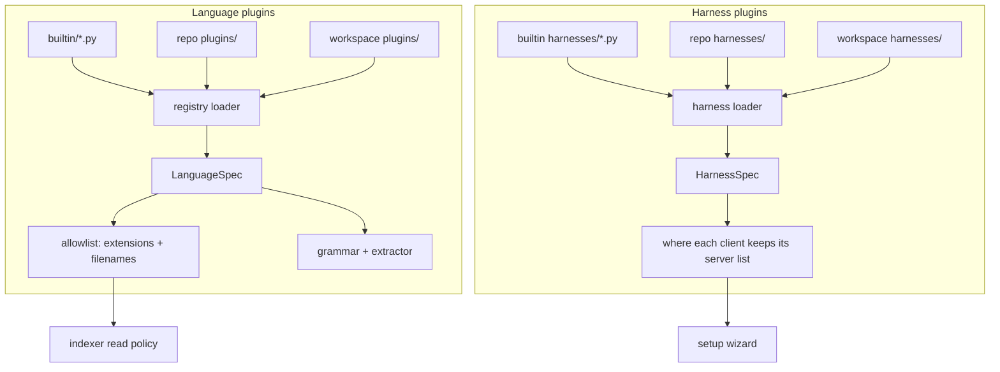

# Plugins

Two independent plugin systems share one idea: **plain modules whose globals are read by a
loader**, dropped into a folder, with the user copy overriding the builtin by `NAME`.

| System | Builtin location | User folders | Purpose |
|---|---|---|---|
| **Language plugins** | `src/simple_code_indexer/builtin/` | `<repo>/plugins/`, `<workspace>/plugins/` | Which files are indexable, and how symbols are extracted |
| **Harness plugins** | `src/simple_code_indexer/harnesses/` | `<repo>/harnesses/`, `<workspace>/harnesses/` | Where each MCP client keeps its server list |

Both loaders are **fail-soft**: a plugin that fails to import or validate is logged and
skipped, never fatal.

## Language Plugins

### Contract

```python
# plugins/zig.py
NAME = "zig"              # language id stored in the index (FileRecord.language)
GRAMMAR = "zig"           # tree_sitter_language_pack.get_parser name
EXTENSIONS = [".zig"]     # dotted suffixes, matched case-insensitively
FILENAMES = ["ZigBuild"]  # exact basenames (Dockerfile-style); optional
SYMBOL_NODES = {          # tree-sitter node type → symbol kind (optional)
    "function_declaration": "function",
    "struct_declaration": "struct",
}

# Optional specialized extractor (replaces the generic name-field walker):
# def extract(root, source): -> list[Symbol]
```

### Rules

- Required: `NAME`, `GRAMMAR`, and at least one of `EXTENSIONS` / `FILENAMES`.
- Bare tokens in `EXTENSIONS` (no leading `.`) are treated as **filenames**.
- Bad plugins (syntax errors, missing fields) are logged and skipped — the server never
  crashes on one.
- Builtin collisions: `.h` → `cpp`, `.m` → `objc`.
- A user plugin overrides a builtin with the same `NAME` **and steals every extension and
  filename it claims** — redeclare the original extensions or the builtin stops matching.
- Changes need a **server restart** (no hot reload).

### Search order

Builtin package → `<repo>/plugins/` → `<workspace>/plugins/`. Later wins.

### What a plugin controls

| Plugin field | Effect on the system |
|---|---|
| `NAME` | `FileRecord.language`; `get_status.plugins_loaded` counts it |
| `GRAMMAR` | The tree-sitter parser loaded lazily and prefetched in the background |
| `EXTENSIONS` / `FILENAMES` | `Settings.allowed_exts` / `allowed_filenames` — the read policy |
| `SYMBOL_NODES` | Merged **over** the generic node→kind map |
| `extract` | Replaces the generic name-field walker entirely |

### Builtin set

36 languages ship in `src/simple_code_indexer/builtin/`: bash, c, cpp, c_sharp, cmake, css,
dart, dockerfile, elixir, elm, erlang, fortran, go, graphql, haskell, html, java,
javascript, julia, kotlin, lua, make, objc, ocaml, perl, php, python, r, ruby, rust, scala,
scss, sql, swift, typescript, vim. **Data and documentation formats are intentionally not
indexed** (json, yaml, markdown, toml, xml, csv, …).

## Harness Plugins

### Contract

```python
NAME = "my_harness"              # required, unique
LABEL = "My Harness"             # shown by the wizard
HOME_DIRS = ["~/.my-harness"]    # detection: any existing dir (or BINARIES on PATH)
BINARIES = ["my-harness"]
GLOBAL_CONFIGS = ["~/.my-harness/mcp.json"]   # user scope
LOCAL_CONFIGS = [".my-harness/mcp.json"]      # project scope (relative to cwd)
FORMAT = "json"                  # or "toml"
ROOT_KEY = "mcpServers"          # JSON root key

def entry(command, env):         # optional; default is command/args/env
    return {"command": command[0], "args": command[1:], "env": env}
```

- If `FORMAT = "toml"`, the plugin must **not** set `ROOT_KEY`; the loader writes a
  marker-delimited `[mcp_servers."simple-code-indexer"]` block.
- A plugin can also provide `render(existing, *, name, command, env) -> str` to fully control
  the merge.
- `%APPDATA%` and `~` are expanded in `HOME_DIRS` and `*_CONFIGS`; entries whose variables do
  not exist on the current platform are ignored.
- Search order: the builtin package → `<repo>/harnesses/` → `<workspace>/harnesses/`.

### Builtin set

Claude Code, Claude Desktop, Codex CLI, Gemini CLI, OpenCode, Cursor, Windsurf, VS Code,
Zed, Cline, Command Code, MiMoCode.

## Example Snippets

A complete user language plugin:

```python
"""User plugin: adds Zig support."""
from __future__ import annotations

from typing import Any

from simple_code_indexer.models import Symbol

NAME = "zig"
GRAMMAR = "zig"
EXTENSIONS = [".zig", ".zon"]
FILENAMES = ["build.zig"]
SYMBOL_NODES = {
    "function_declaration": "function",
    "struct_declaration": "struct",
    "variable_declaration": "variable",
}
```

A complete user harness plugin:

```python
"""User plugin: teaches the wizard about a hypothetical client."""
NAME = "my_harness"
LABEL = "My Harness"
HOME_DIRS = ["~/.my-harness"]
BINARIES = ["my-harness"]
GLOBAL_CONFIGS = ["~/.my-harness/mcp.json"]
LOCAL_CONFIGS = [".my-harness/mcp.json"]
FORMAT = "json"
ROOT_KEY = "mcpServers"
```

The plugin-name validation that makes a bad plugin harmless:

```python
def _spec_from_module(module: ModuleType, path: Path) -> LanguageSpec | None:
    name = getattr(module, "NAME", None)
    grammar = getattr(module, "GRAMMAR", None)
    if not isinstance(name, str) or not name:
        logger.warning("plugin %s missing NAME", path)
        return None
    if not isinstance(grammar, str) or not grammar:
        logger.warning("plugin %s missing GRAMMAR", path)
        return None
    extensions, filenames = _tokens(module, path, name)
    if not extensions and not filenames:
        logger.warning("plugin %s declares no EXTENSIONS/FILENAMES", path)
        return None
    ...
```

## Edge Cases

- **User override is silent** — a debug log only. `plugins/cpp.py` replaces the builtin by
  `NAME` and frees/reclaims its extensions.
- **`detect_language` returns the plugin `NAME`** (e.g. `c_sharp`), not the pack grammar
  (`csharp`).
- **Grammar download** — the language pack fetches grammars on demand; a fresh machine has
  only `cpp` and `python` locally. Offline first use falls back to the regex symbol scan.
- **Files starting with `_`** in a plugin folder are treated as helpers, not plugins.
- **JSONC comments are lost on rewrite** — `_json.py` strips them to parse OpenCode files and
  writes strict JSON. The file is backed up first and the write is refused if the result
  cannot be parsed.
- **TOML is merged with marker comments** (`# >>> simple-code-indexer >>>`), not a round-trip,
  because `tomllib` cannot write and a rewrite would destroy user comments and ordering.
- **Command Code detection must not use the `cmd` binary** — on Windows that is the shell, so
  every machine would look like it has Command Code installed.
- **Restart required** — plugin changes are not picked up by a running server.

## Diagrams



## Source References

- `src/simple_code_indexer/registry.py`
- `src/simple_code_indexer/builtin/_c_family.py`
- `src/simple_code_indexer/builtin/cpp.py`
- `src/simple_code_indexer/builtin/dockerfile.py`
- `src/simple_code_indexer/harnesses/__init__.py`
- `src/simple_code_indexer/harnesses/_json.py`
- `src/simple_code_indexer/harnesses/_toml.py`
- `src/simple_code_indexer/harnesses/mimo.py`
- `src/simple_code_indexer/harnesses/codex.py`
- `src/simple_code_indexer/parse.py`
- `src/simple_code_indexer/setup_wizard/__init__.py`
- `plugins/README.md`
- `harnesses/README.md`
- `tests/test_registry.py`
- `tests/test_harnesses.py`