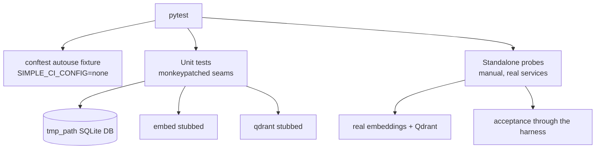

# Testing

## Strategy

The suite is **hermetic by default**: no Docker, no network, no real embedding endpoint, no
real Qdrant. Every external effect has an injection seam (a monkeypatched module function, a
fake `Runner`, a fake `Http`, a fake `Prompter`). Integration behaviour is exercised by three
**standalone probe scripts** that are run manually against real services.

| Layer | Runner | Needs services? |
|---|---|---|
| Unit | `uv run pytest` | No |
| Integration probes | `uv run python tests/<probe>.py` | Yes |
| Acceptance | Through the harness | Yes |

## Test Inventory

| File | Tests | Focus |
|---|---|---|
| `tests/test_config.py` | 10 | Env overrides, defaults, collection derivation, allowlists |
| `tests/test_configfile.py` | 13 | Discovery order, `SIMPLE_CI_CONFIG`, typed getters, atomic write |
| `tests/test_db.py` | 11 | Schema, upsert/delete, FTS hit shape, symbol lookup, stats |
| `tests/test_embed.py` | 6 | Split/pool, retries, count and dimension validation, `LAST_OK` |
| `tests/test_harnesses.py` | 16 | Plugin contract, path expansion, JSON/TOML merges, detection |
| `tests/test_indexer.py` | 7 | Index end-to-end, hash short-circuit, re-embed, sweep drift |
| `tests/test_multi_workspace_isolation.py` | 1 | Two workspaces, two collections, no cross-hits (spawns a child process) |
| `tests/test_parse.py` | 7 | Symbol extraction, chunk bounds, the fallback path |
| `tests/test_qdrant_store.py` | 8 | Point-ID stability, payload, the collection guard, error paths |
| `tests/test_registry.py` | 10 | Plugin loading, validation, collisions, allowlists, prefetch |
| `tests/test_services.py` | 11 | Container states, probes, the Docker-daemon path, fail-soft |
| `tests/test_setup_wizard.py` | 9 | The full wizard flow with injected prompts/runner/HTTP |
| `tests/test_smoke.py` | 1 | The package imports and `main` is wired |
| `tests/test_watcher.py` | 3 | Handler filtering and debounce |
| `tests/test_workspace_lock.py` | 3 | Acquisition, contention, release |

## Running the Suite

```bash
uv run pytest                                                  # everything
uv run pytest tests/test_smoke.py::test_main_imports           # one test
uv run pytest -p no:cacheprovider --basetemp <writable dir>    # on this host
```

**On this host** `%TEMP%\pytest-of-KJ` and `.pytest_cache/` are unreadable and undeletable
for the current user (they were created by container root over the bind mount). Every
`tmp_path` test fails until an elevated shell removes them; the workaround is
`--basetemp <writable dir>` with `-p no:cacheprovider`.

## Example Snippets

The autouse fixture that keeps a developer's global config out of the tests:

```python
@pytest.fixture(autouse=True)
def _no_ambient_config(monkeypatch) -> None:
    """Never let a developer's ~/.simple-ci/config.yaml change test defaults."""
    monkeypatch.setenv("SIMPLE_CI_CONFIG", "none")
```

The autouse fixture that keeps the unit tests off the network:

```python
@pytest.fixture(autouse=True)
def _no_embed_network(monkeypatch) -> None:
    """Unit tests index lexically; embedding failure path is test_embed's job."""

    def _stub(settings, texts):
        raise EmbedError("stubbed out in unit tests")

    monkeypatch.setattr(embed, "embed_texts", _stub)
```

A hermetic `Settings` built in the test itself:

```python
def _settings(workspace: Path) -> Settings:
    registry = get_registry()
    return Settings(
        workspace_root=workspace,
        index_db_path=workspace / ".simple-ci" / "index.db",
        qdrant_url="http://localhost:6333",
        qdrant_collection="code_index_2560",
        embed_base_url="http://localhost:1",  # hermetic: fail-soft embed path
        embed_model="Qwen3-Embedding-4B-Q6_K",
        embed_dim=2560,
        embed_timeout_s=15.0,
        sweep_seconds=45.0,
        debounce_ms=400,
        allowed_exts=registry.extension_allowlist(),
        allowed_filenames=registry.filename_allowlist(),
        ignore_dirs=IGNORE_DIRS,
    )
```

The behaviour that proves the re-embed path is independent of the hash short-circuit:

```python
def test_sweep_reembeds_failed_chunks_without_file_changes(tmp_path, monkeypatch):
    ...
    stats = indexer.sweep(settings)
    assert stats.unchanged == 1
    assert embedded  # retried despite the unchanged hash/mtime short circuit
    assert upserted == ["a.cpp"]

    embedded.clear()
    indexer.sweep(settings)
    assert embedded == []  # successful chunks are not re-embedded
```

## Test Seams

| Module | Seam | Why |
|---|---|---|
| `embed.py` | `embed.embed_texts` is monkeypatched | No HTTP in unit tests |
| `qdrant_store.py` | `qdrant_store.upsert_chunks` is monkeypatched | No Qdrant in unit tests |
| `services.py` | `_run`, `_popen`, `_which`, `_clock`, `_sleep` | No Docker, no waiting |
| `setup_wizard/provision.py` | `provision.Runner` | No subprocesses |
| `setup_wizard/probe.py` | `probe.Http` | No HTTP |
| `setup_wizard/prompts.py` | `prompts.Prompter` | No `input()` |
| `configfile.py` | `SIMPLE_CI_CONFIG=none` | No ambient config |
| `registry.py` | `reset_registry()`, `load_registry(user_dirs=…)` | Isolated plugin sets |

## Edge Cases

- **Child-process tests** — `test_multi_workspace_isolation` spawns a server subprocess, so it
  must set `SIMPLE_CI_CONFIG` itself; a `monkeypatch` is not inherited by a child process.
- **Grammars that are not downloaded** — tests that parse non-Python/C++ languages stub
  `parse._parser`.
- **Loopback to a closed port takes 2–4 s to fail** on this host, so no unit test may hit the
  network; `embed.py` caps its connect timeout at 1 s.
- **A downed endpoint must cost one retry per sweep, not one per file** — asserted by
  `test_reembed_stops_at_the_first_failing_file`.
- **Semantic isolation** — assert "every hit comes from this workspace", never "an unrelated
  query returns nothing": a semantic query is nearest-chunk and always returns the workspace's
  own closest chunk.
- **Windows** — the workspace lock behaves differently per platform; both branches are
  exercised through the same public API.

## Quality Gates

Run in this order before calling work done:

```bash
uv run ruff check .
uv run ruff format .
uv run pyright
uv run pytest
```

`pyright` runs in `standard` mode over `src`, `tests` and `setup.py` with `pythonVersion = 3.12`.

## Diagrams



## Source References

- `tests/conftest.py`
- `tests/test_config.py`
- `tests/test_configfile.py`
- `tests/test_db.py`
- `tests/test_embed.py`
- `tests/test_harnesses.py`
- `tests/test_indexer.py`
- `tests/test_multi_workspace_isolation.py`
- `tests/test_parse.py`
- `tests/test_qdrant_store.py`
- `tests/test_registry.py`
- `tests/test_services.py`
- `tests/test_setup_wizard.py`
- `tests/test_smoke.py`
- `tests/test_watcher.py`
- `tests/test_workspace_lock.py`
- `tests/service_probe.py`
- `tests/mcp_probe.py`
- `tests/live_watch_probe.py`
- `tests/fixtures/widget_checksum.cpp`
- `pyproject.toml`
- `AGENTS.md`
- `docs/tdd.md`