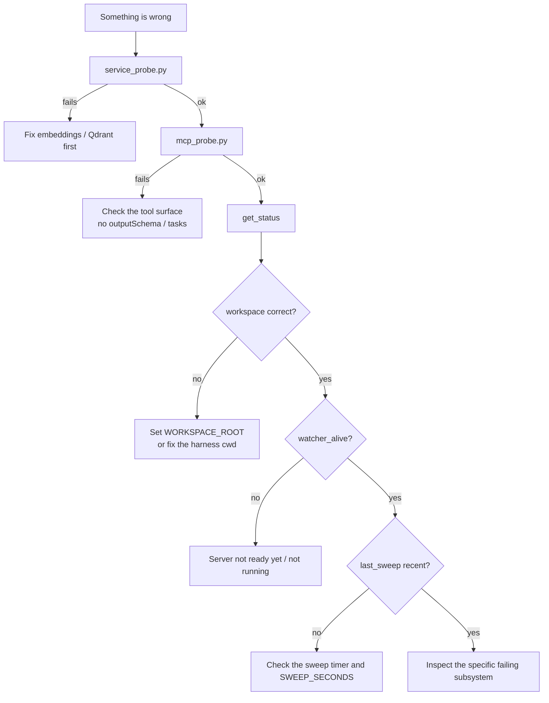

# Troubleshooting

## Symptom Index

| Symptom | Likely cause | Fix |
|---|---|---|
| Wizard says Docker is unavailable | Docker Desktop not running | Start it, or choose the URL/container-less branches |
| Port already in use | 8080 / 6333 taken | The wizard picks the next free port and writes it to the config |
| `get_status.services` shows `unavailable` | The managed container failed | `docker ps -a`, inspect the container logs, re-run `python setup.py` |
| Changed the embedding model | The dimension changed | The collection name changed and the index re-embeds — expected |
| Config changes ignored | The server reads config at startup | Restart the harness session |
| `.simple-ci/index.db` deleted | — | Nothing to restore: the startup reconcile re-indexes the workspace |
| Want a clean rebuild | — | Delete `.simple-ci/` (or only `index.db`) and trigger an MCP call |

## MCP Harness Failures

| Symptom | Check |
|---|---|
| `mimo mcp list` → `Failed to get tools` | Run `tests/mcp_probe.py`; it fails loudly on `outputSchema` / `tasks` regressions. The first `uvx` launch legitimately takes ~5 s; a managed container takes longer — raise the harness timeout |
| The harness does not show the server | The entry is `uvx --from <repo> simple-code-indexer`; confirm the config file the harness actually reads |
| `tools/list` payload rejected | Do not add `outputSchema`, `capabilities.tasks` or `execution.taskSupport` (ADR-0006) |

## Indexing Failures

| Symptom | Check |
|---|---|
| Indexing the wrong tree / unexpected `collection` | `get_status.workspace` shows the resolved workspace. If the harness did not spawn the server in your project, set `WORKSPACE_ROOT` |
| `watcher_alive: false` | The server is not running or still starting; the watcher registers on a background thread (true within ~1 s of the first call) |
| Save not picked up within 5 s | The reconciliation sweep (45 s) is the backstop; check `last_sweep` in `get_status` |
| A file is never indexed | Its extension/filename is not claimed by any plugin — check `get_status.plugins_loaded` and the plugin contract |
| A file is indexed but its symbols are missing | The grammar is not downloaded and the regex fallback found nothing; check `grammars_ready` |
| Semantic hits empty but lexical works | The collection changed without a rebuild (restart the session), or vectors failed earlier — the next sweep retries chunks whose `embedding_state` is not `ok`; if the log reports a vector-size mismatch, delete the collection or align `EMBED_DIM` |
| `config_file: null` in `get_status` | Neither `<workspace>/.simple-ci/config.yaml` nor `~/.simple-ci/config.yaml` exists; run `python setup.py` or create one |
| Server exits with `already owns …index.db` | Two sessions share one workspace; the second refuses to start (single writer, ADR-0004). Close the other session |
| Logs | stderr of the spawned server (harness); never files in the workspace root |

## Service Failures

| Symptom | Check |
|---|---|
| `qdrant_ok` / `embed_ok: false` | `tests/service_probe.py`; check `get_status.services` and the Docker container logs |
| Embedding returns HTTP 500 "input is too large" | The llama.cpp batch limit is 512 tokens; `embed.py` splits at 1200 chars — keep that guard if you change chunk sizes |
| Dimension mismatch in the log | `EMBED_DIM` does not match the endpoint. The wizard probes it; align the config or delete the collection |
| Qdrant "vector size N, expected M" | The collection was created with a different dimension. Delete it, or point `QDRANT_COLLECTION` at a fresh name |
| Loopback connection takes seconds to fail | Expected on this Windows host; the embed client caps its connect timeout at 1 s |

## Environment and Tooling Failures

| Symptom | Fix |
|---|---|
| `uv run pytest` fails on every `tmp_path` test | `%TEMP%\pytest-of-KJ` and `.pytest_cache/` are unreadable here — use `uv run pytest -p no:cacheprovider --basetemp <writable dir>` |
| `uv run` re-syncs and prints build lines on every edit | Expected; `uv run` re-syncs after each source change. Not a hang |
| The first `uvx` launch is slow (~5 s) | It builds and installs into a cached environment; later launches are ~0.3 s. `uv tool install --from <repo>` removes even that |
| A developer's global config changes test results | The autouse fixture sets `SIMPLE_CI_CONFIG=none`; a child-process test must set it too (a monkeypatch is not inherited) |
| Ruff wants to rewrite `docs/tdd.md` | `pyproject.toml` excludes `*.md` from ruff — the TDD is the build contract |

## Performance Traps

| Trap | Rule |
|---|---|
| `Path.rglob("*")` over the workspace | It descends into `.venv` (tens of thousands of files) over the Docker Desktop bind mount. Use `os.walk` + `dirnames[:]` pruning, as `indexer.iter_workspace_files` does |
| `observer.schedule(..., recursive=True)` | Registration blocks for >10 s over `.venv` and `watcher_alive` never goes true. Register one non-recursive watch per directory |
| A downed embedding endpoint | The sweep retries pending chunks and **stops at the first failing file**, so the cost is one retry per sweep, not one per file |
| `ensure_collection` on a fresh workspace | The service-probe thread, the index writer and a semantic search all race to create it. The in-process lock plus the re-check on a failed create makes the losers safe — an unguarded check-then-create answered `409` and silently cost the workspace every vector |

## Diagnostics Checklist

```bash
# 1. Services first, always
uv run python tests/service_probe.py

# 2. The MCP contract
PROBE_SYMBOL=calculateWidgetChecksum uv run python tests/mcp_probe.py

# 3. Index-on-save latency
uv run python tests/live_watch_probe.py

# 4. What the live server thinks
#    call get_status and read: workspace, collection, index_db, config_file,
#    watcher_alive, last_sweep, qdrant_ok, embed_ok, plugins_loaded, grammars_ready, services
```

## Isolation Testing Rule

A semantic query is **nearest-chunk**, not a lexical match: asking a workspace for a symbol it
does not contain still returns that workspace's own closest chunk. Isolation tests must
assert *"every hit comes from this workspace"* — never *"an unrelated query returns
nothing"*.

## Diagnostics


## Diagrams



The diagnostic order: services first, then the MCP contract, then the live
status fields.
## Source References

- `README.md` (the runbook and diagnosis tables)
- `NOTES.md` (the gotchas this page is derived from)
- `ISSUES.md` (the open-issue tracker)
- `src/simple_code_indexer/server.py`
- `src/simple_code_indexer/services.py`
- `src/simple_code_indexer/embed.py`
- `src/simple_code_indexer/qdrant_store.py`
- `src/simple_code_indexer/indexer.py`
- `src/simple_code_indexer/watcher.py`
- `src/simple_code_indexer/config.py`
- `src/simple_code_indexer/workspace_lock.py`
- `tests/service_probe.py`
- `tests/mcp_probe.py`
- `tests/live_watch_probe.py`
- `pyproject.toml`
- `docs/tdd.md`